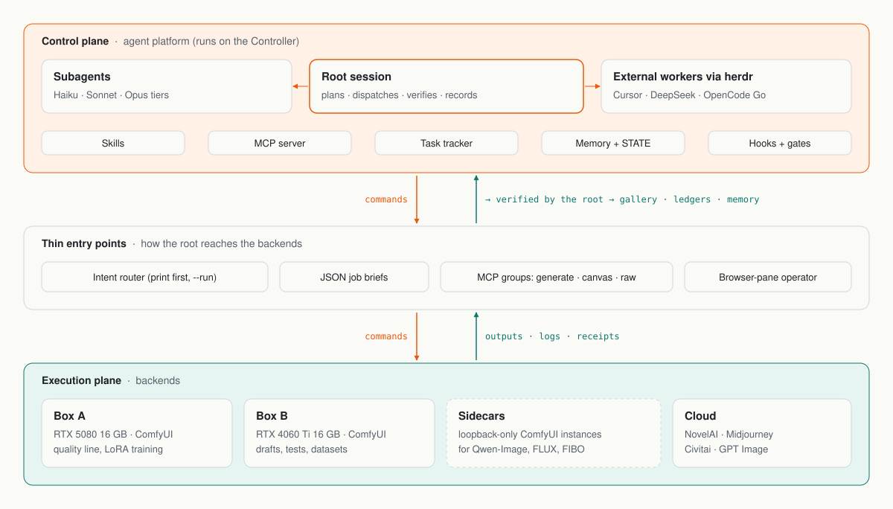
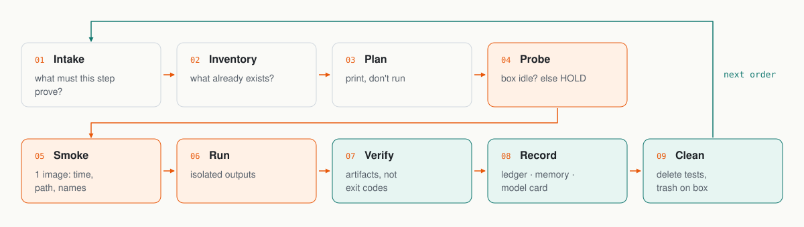

<p align="center">
  <picture>
    <source media="(prefers-color-scheme: dark) and (max-width: 600px)" srcset="assets/banner-narrow-dark.svg">
    <source media="(max-width: 600px)" srcset="assets/banner-narrow-light.svg">
    <source media="(prefers-color-scheme: dark)" srcset="assets/banner-dark.svg">
    
  </picture>
</p>

<p align="center"><b>Agent-first methods for running, debugging and deploying local generative models</b></p>

<p align="center">
  <b>English</b> · <a href="README.zh-CN.md">中文</a>
  &nbsp;&nbsp;|&nbsp;&nbsp;
  <a href="#quickstart-zero-custom-node-comfyui-starter-pack-v010">Starter Pack</a> · <a href="docs/INDEX.md">Index</a> · <a href="#what-is-inside">Docs</a> · <a href="#use-the-skill">Skill</a> · <a href="workflows/">Workflows</a> · <a href="templates/">Templates</a> · <a href="tools/">Tools</a>
</p>

<p align="center">
  <a href="LICENSE"></a>
  <a href="README.zh-CN.md"></a>
  <a href="https://github.com/lepetitprince716-prog/agent-genops/releases/tag/v0.1.0"></a>
  
</p>

How I run, debug and deploy local image and video models with coding agents. The agents plan
the work, dispatch it, check the results and keep the records. ComfyUI and the cloud services
(NovelAI, Midjourney, Civitai, GPT Image) only render.

This is a working method, not a library. It comes from one real setup, a laptop that runs the
agents and two consumer GPUs that render, and it keeps the numbers, dates and incidents that
shaped each rule. The [skill](skills/agent-genops/) in this repo lets an agent load the same
method.

## Quickstart: Zero-Custom-Node ComfyUI Starter Pack (`v0.1.0`)

Want ready-to-drag ComfyUI `>= 0.42` workflows, a zero-dependency sweep script, and a drop-in coding-agent skill without cloning the full monorepo?

- **Direct Download (`~568 KB`)**: **[`agent-comfyui-starter-v0.1.0.zip`](https://github.com/lepetitprince716-prog/agent-genops/releases/download/v0.1.0/agent-comfyui-starter-v0.1.0.zip)** · [Release Notes (`v0.1.0`)](https://github.com/lepetitprince716-prog/agent-genops/releases/tag/v0.1.0)
- **Inside the Starter Pack** (`100%` core ComfyUI nodes, Python 3.10+ stdlib only):
  1. `workflows/compiled/*.ui.json` & `*.api.json` — Drag-and-drop canvases compiled with [`cwc`](https://github.com/lepetitprince716-prog/comfyui-workflow-compiler) (`01-moss-fast12-hires-20s` 2-pass 1.5x HiRes + `02-moss-style-lora-ab` optional `Ctrl+B` style toggle) plus vector `.svg` previews.
  2. `comfy_sweep.py` — Zero-`pip` CLI (`probe`, `smoke`, `sweep`, and pure-Python PNG 2D Laplacian `metrics` contact sheet).
  3. `skills/comfyui-zero-node-pilot/SKILL.md` — Compact Agent Skill for Claude Code, Cursor, Codex, Antigravity, and OpenCode.
- **Companion Open Weights & Standard SDXL Graphs**: Free SFW LoRAs and workflows at **[civitai.com/user/lepetitprince716355](https://civitai.com/user/lepetitprince716355)** (`#3063613` Fast-12 OPD, `#3061816` IceBrush), plus minimal SDXL baselines in [`workflows/`](workflows/).

```bash
unzip agent-comfyui-starter-v0.1.0.zip && cd agent-comfyui-starter
python3 comfy_sweep.py probe --url http://127.0.0.1:8188
python3 comfy_sweep.py smoke workflows/compiled/01-moss-fast12-hires-20s.api.json
```

## Five ideas behind the 24 rules

1. Agents plan, dispatch, verify and record. ComfyUI and the cloud services only render.
2. The live machine and the artifact on disk are the truth. Documents, exit codes and
   self-reports are claims.
3. GPU time, paid credits and the owner's attention are the scarce resources.
4. Machines eliminate candidates. Taste is decided by a person.
5. Write down what was measured, what was assumed and what is still unverified. Keep the
   lesson, delete the test images.

The [24 rules](docs/en/00-philosophy.md) come in six groups:
[Where the work lives](docs/en/00-philosophy.md#1-where-the-work-lives) (rules 1–4) ·
[Truth and evidence](docs/en/00-philosophy.md#2-truth-and-evidence) (5–8) ·
[Scarce resources](docs/en/00-philosophy.md#3-scarce-resources) (9–13) ·
[Agents and dispatch](docs/en/00-philosophy.md#4-agents-and-dispatch) (14–17) ·
[Memory and honesty](docs/en/00-philosophy.md#5-memory-and-honesty) (18–21) ·
[Creative work](docs/en/00-philosophy.md#6-creative-work) (22–24).
Each page adds working rules of its own; a number such as "rule 13" refers to the numbered
list it sits in on its own page.

## The idea

<p align="center">
  <a href="assets/architecture-light.svg">
    <picture>
      <source media="(prefers-color-scheme: dark) and (max-width: 600px)" srcset="assets/architecture-narrow-dark.svg">
      <source media="(max-width: 600px)" srcset="assets/architecture-narrow-light.svg">
      <source media="(prefers-color-scheme: dark)" srcset="assets/architecture-dark.svg">
      
    </picture>
  </a>
</p>

Most agent tooling for image generation lives inside ComfyUI or sits next to it as a bridge.
This repo puts the agent above every backend. Planning, dispatch, budgets, verification and
memory happen on the agent platform; a ComfyUI box or a cloud service is an executor that can
be swapped.

| Where the agent lives | What it can do |
|---|---|
| Inside ComfyUI (copilot panels, LLM nodes in the graph) | Help build or edit one graph |
| Beside ComfyUI (MCP servers, bridges) | Submit graphs, list models, fetch outputs |
| Above all backends (this repo) | Route work across local boxes and cloud services, delegate it to cheaper models, hold budgets, verify artifacts, remember what was learned |

[Architecture](docs/en/01-architecture.md) names the public projects in the first two rows and
says where this approach differs.

## The loop

<p align="center">
  <a href="assets/loop-light.svg">
    <picture>
      <source media="(prefers-color-scheme: dark) and (max-width: 600px)" srcset="assets/loop-narrow-dark.svg">
      <source media="(max-width: 600px)" srcset="assets/loop-narrow-light.svg">
      <source media="(prefers-color-scheme: dark)" srcset="assets/loop-dark.svg">
      
    </picture>
  </a>
</p>

Every job, from one test image to bringing up a new model, goes through the same steps:

1. **Intake**: what must this step prove?
2. **Inventory**: what already exists (scripts, recipes, models, earlier results)?
3. **Plan**: print the command; do not run it yet.
4. **Probe**: is the box idle and does it have the models? If not, HOLD.
5. **Smoke**: one image; check time per image, output path, file names.
6. **Run**: the batch, with outputs isolated per job.
7. **Verify**: open the artifacts; exit codes and self-reports are not evidence.
8. **Record**: ledgers, memory, model cards.
9. **Clean**: delete test renders on both sides; trash folders, not recycle bins.

## What is inside

Where to start: read [Philosophy](docs/en/00-philosophy.md) first, then the row that fits your
setup.

| Your setup | Then read |
|---|---|
| One GPU in the machine you work on | [Render discipline](docs/en/06-render-discipline.md), [Debugging](docs/en/05-debugging.md), [Model bring-up](docs/en/04-model-bringup.md), [Performance](docs/en/07-performance.md) |
| Cloud services only | [Providers](docs/en/09-providers.md), [Prompting and review](docs/en/10-prompting-and-review.md), [Inventory](docs/en/08-inventory.md) |
| Several machines and several agents | [Architecture](docs/en/01-architecture.md), [Environment](docs/en/02-environment.md), [Dispatch](docs/en/03-dispatch.md), [Continuity](docs/en/12-continuity.md) |

| Page | What it answers |
|---|---|
| [Philosophy](docs/en/00-philosophy.md) | The 24 working rules and why each one exists |
| [Architecture](docs/en/01-architecture.md) | How the control plane and the execution plane connect |
| [Environment](docs/en/02-environment.md) | The reference hardware and what runs where |
| [Dispatch](docs/en/03-dispatch.md) | Which model tier gets which job; task packets; acceptance |
| [Model bring-up](docs/en/04-model-bringup.md) | Adopting a new model or runtime, from download to verdict |
| [Debugging](docs/en/05-debugging.md) | Symptom, likely cause, first check; remote Windows traps |
| [Render discipline](docs/en/06-render-discipline.md) | Smoke tests, isolation, queues, GPU etiquette, cleanup |
| [Performance](docs/en/07-performance.md) | A/B method, variance, quantization and distillation verdicts |
| [Inventory](docs/en/08-inventory.md) | Models, LoRAs, recipes, outputs, archives, ledgers |
| [Providers](docs/en/09-providers.md) | Local boxes, NovelAI, Midjourney, Civitai, GPT Image |
| [Prompting and review](docs/en/10-prompting-and-review.md) | Per-model prompt rules, delegated prompt writing, the taste method |
| [Safety and privacy](docs/en/11-safety-and-privacy.md) | Managed egress, gates, secrets, the public/private split |
| [Continuity](docs/en/12-continuity.md) | Memory files, state snapshots, handoffs, the task tracker |
| [Lessons](docs/en/13-lessons.md) | Dated incidents and the rules they produced |

The pages name the author's own scripts (an intent router, a model index, ledgers) as examples.
They do not ship with this repo. The roles table in [SKILL.md](skills/agent-genops/SKILL.md) says
what each one has to do and what a plain ComfyUI can stand in with;
[templates/LOCAL.example.md](templates/LOCAL.example.md) is where you write down your own.
Unfamiliar terms are in the [glossary](skills/agent-genops/references/glossary.md).

Also in the repo: [templates/](templates/) (task packet, model card, A/B write-up, run order,
handoff, memory entry, LOCAL.md, subagent definitions) and [tools/](tools/) (the privacy scanner
this repo runs on itself, plus a GPU kernel classifier and a GEMM probe from the performance page).

Three projects live in folders of their own. Each has its own README with the build and test
commands.

| Folder | What it is | Start with |
|---|---|---|
| [cwc/](cwc/) | `cwc`, a Python tool that turns a ComfyUI API graph into a native canvas workflow: grouped, laid out by a preset, routed with link reroutes, and checked to export the same prompt it was compiled from. Pre-alpha. | [cwc/README.md](cwc/README.md) |
| [rdbg/](rdbg/) | `rdbg`, a Rust command line that runs PowerShell on a Windows host over the system `ssh`, without shell quoting problems. Early. | [rdbg/README.md](rdbg/README.md) |
| [artfetch/](artfetch/) | `artfetch`, a Rust command line for multi-source illustration discovery, dataset harvesting, cross-platform deduplication and staging as 1536 px JPEGs. | [artfetch/README.md](artfetch/README.md) |

## Use the skill

The skill is one folder, [`skills/agent-genops/`](skills/agent-genops/): a `SKILL.md` and a
`references/` directory that the agent opens on demand.

In Claude Code the repo also works as a plugin marketplace. Add the marketplace, then install the
plugin:

```text
/plugin marketplace add lepetitprince716-prog/agent-genops
/plugin install agent-genops@agent-genops
```

After installing:

1. Run `/reload-plugins` if the install asks for it, or start a new session. Then ask the agent
   which skills it has; `agent-genops` should be in the list.
2. Copy [templates/LOCAL.example.md](templates/LOCAL.example.md) to
   `~/.config/agent-genops/LOCAL.md` and fill in what plays each role on your machine. The file
   stays on your machine.
3. Optional: copy the files in [templates/agents/](templates/agents/) to `~/.claude/agents/` for
   the subagent tiers the skill dispatches to. The plugin does not install them.
4. Try it: "Use agent-genops to plan one smoke render on my ComfyUI at http://127.0.0.1:8188."

<details>
<summary>Other agents and local copies</summary>

For other agents, or to keep a local copy, clone the repo and link the skill folder to wherever
your agent loads skills from. The commands use Claude Code's folder; swap in yours from the table.

```bash
git clone https://github.com/lepetitprince716-prog/agent-genops.git ~/agent-genops
mkdir -p ~/.claude/skills
ln -s ~/agent-genops/skills/agent-genops ~/.claude/skills/agent-genops
```

| Agent | Skill folder |
|---|---|
| Claude Code | `~/.claude/skills/` (or `.claude/skills/` in a project) |
| Codex | `~/.agents/skills/` (or `.agents/skills/` in a project) |
| Cursor | `~/.cursor/skills/` or `~/.agents/skills/` |
| Grok Build | `~/.grok/skills/` (or `.grok/skills/` in a project) |

The templates stay in the clone, so put the clone's path in LOCAL.md. Start a new session after
linking and check that the agent lists the skill.

</details>

## Dispatch at a glance

| Job | Goes to |
|---|---|
| Bulk reading, extraction, log digests, run-and-report | Haiku worker |
| Research that must combine sources; retry after a Haiku miss | Sonnet worker |
| Ordinary implementation and debugging | Opus worker, medium effort |
| Multi-file changes, design calls, anything with a contract | Opus worker, high effort |
| Code for a design that is already settled; long tuning runs with a clear goal | Sonnet worker, max effort |
| Review of a plan before it runs | Plan reviewer |
| Claims about code, tests or libraries before a commit | Fact checker |
| Parallel lanes on other vendors' models | herdr workers (Cursor Composer, DeepSeek) |

Work that is one chain of steps stays in the root session. See [Dispatch](docs/en/03-dispatch.md).
The tier names are the subagent definitions in [templates/agents/](templates/agents/); with
another agent, map them to your cheapest, default and strongest model.

## Reference setup

| Machine | Hardware | Role |
|---|---|---|
| Controller | MacBook Air, Apple M5 (10 cores), 24 GB | Runs the agents. Renders nothing. |
| Box A | Windows, NVIDIA RTX 5080 16 GB, AMD Ryzen 7 9800X3D, about 48 GB RAM | Quality line and LoRA training. Also the owner's gaming PC, so agents yield to it. Sleeps when idle since 2026-10-13. |
| Box B | Windows, NVIDIA RTX 4060 Ti 16 GB, 32 GB RAM | Drafts, tests and datasets. Sleeps when idle. |
| Linux node | NVIDIA DGX Spark pair (head plus one worker) | Batch jobs and model services |

Agent side: Claude Code with an Opus 5.5 root session and Haiku, Sonnet and Opus subagents;
[herdr](https://github.com/herdrdev/herdr) for external workers (Cursor Composer 2.5,
DeepSeek); [bd (beads)](https://github.com/gastownhall/beads) for task tracking. Render side:
ComfyUI 0.42.1 on both boxes, plus loopback-only sidecar instances for newer models.

## Keeping this repo clean

This repo is public and its history has to stay free of personal data.
[`tools/privacy_scan.py`](tools/privacy_scan.py) looks for LAN addresses, home paths, emails,
token shapes and image-generation metadata. It runs in git hooks and in CI. The hooks and the
scanner cover the whole repository, the three project folders included; the project folders
carry no guard of their own. Turn the hooks on after cloning:

```bash
git config core.hooksPath .githooks
```

Private patterns (names, hostnames, domains) belong in
`~/.config/agent-genops/private_rules.json`, outside the repo. See [PRIVACY.md](PRIVACY.md).

## Status

Field notes as of October 2026. The numbers come from one setup and carry their date, hardware
and ComfyUI version; read them as data points, not benchmarks. Pages mark items that are stale
or unverified.

## Contributing and license

Issues and pull requests are welcome; read [CONTRIBUTING.md](CONTRIBUTING.md) first. The docs, skill,
templates and tools at the top level are under the [MIT License](LICENSE). Each project folder
carries its own license files:

- [cwc/](cwc/LICENSE) is under the Apache License 2.0. Files that `cwc` generates belong to whoever
  owns the workflow they were made from; [cwc/LICENSE-OUTPUTS.md](cwc/LICENSE-OUTPUTS.md) says so.
- [rdbg/](rdbg/) is under either the [Apache License 2.0](rdbg/LICENSE-APACHE) or the
  [MIT License](rdbg/LICENSE-MIT), at your option.
- [artfetch/](artfetch/LICENSE) is under the Apache License 2.0.
