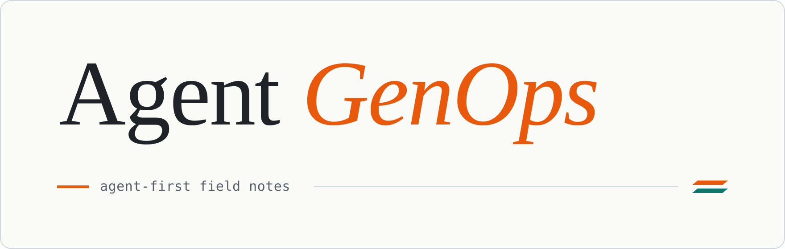

English | [中文](README.zh-CN.md)

<p align="center">
  <picture>
    <source media="(prefers-color-scheme: dark)" srcset="assets/banner-dark.svg">
    
  </picture>
</p>

<p align="center">
  <a href="LICENSE"></a>
  <a href="README.zh-CN.md"></a>
  
</p>

# Agent GenOps

How I run, debug and deploy local image and video models with coding agents. The agents plan
the work, dispatch it, check the results and keep the records. ComfyUI and the cloud services
(NovelAI, Midjourney, Civitai, GPT Image) only render.

This is a working method, not a library. It comes from one real setup, a laptop that runs the
agents and two consumer GPUs that render, and it keeps the numbers, dates and incidents that
shaped each rule. The [skill](skills/agent-genops/) in this repo lets an agent load the same
method.

## The idea

<p align="center">
  <picture>
    <source media="(prefers-color-scheme: dark)" srcset="assets/architecture-dark.svg">
    
  </picture>
</p>

Most agent tooling for image generation lives inside ComfyUI or sits next to it as a bridge.
This repo puts the agent above every backend. Planning, dispatch, budgets, verification and
memory happen on the agent platform; a ComfyUI box or a cloud service is an executor that can
be swapped.

| Where the agent lives | What it can do |
|---|---|
| Inside ComfyUI (copilot panels, LLM nodes in the graph) | Help build or edit one graph |
| Beside ComfyUI (MCP servers, bridges) | Submit graphs, list models, fetch outputs |
| Above all backends (this repo) | Route work across local boxes and cloud services, delegate it to cheaper models, hold budgets, verify artifacts, remember what was learned |

[Architecture](docs/en/01-architecture.md) names the public projects in the first two rows and
says where this approach differs.

## The loop

<p align="center">
  <picture>
    <source media="(prefers-color-scheme: dark)" srcset="assets/loop-dark.svg">
    
  </picture>
</p>

Every job, from one test image to bringing up a new model, goes through the same steps:

1. **Intake**: what must this step prove?
2. **Inventory**: what already exists (scripts, recipes, models, earlier results)?
3. **Plan**: print the command; do not run it yet.
4. **Probe**: is the box idle and does it have the models? If not, HOLD.
5. **Smoke**: one image; check time per image, output path, file names.
6. **Run**: the batch, with outputs isolated per job.
7. **Verify**: open the artifacts; exit codes and self-reports are not evidence.
8. **Record**: ledgers, memory, model cards.
9. **Clean**: delete test renders on both sides; trash folders, not recycle bins.

## What is inside

| Page | What it answers |
|---|---|
| [Philosophy](docs/en/00-philosophy.md) | The 24 working rules and why each one exists |
| [Architecture](docs/en/01-architecture.md) | How the control plane and the execution plane connect |
| [Environment](docs/en/02-environment.md) | The reference hardware and what runs where |
| [Dispatch](docs/en/03-dispatch.md) | Which model tier gets which job; task packets; acceptance |
| [Model bring-up](docs/en/04-model-bringup.md) | Adopting a new model or runtime, from download to verdict |
| [Debugging](docs/en/05-debugging.md) | Symptom, likely cause, first check; remote Windows traps |
| [Render discipline](docs/en/06-render-discipline.md) | Smoke tests, isolation, queues, GPU etiquette, cleanup |
| [Performance](docs/en/07-performance.md) | A/B method, variance, quantization and distillation verdicts |
| [Inventory](docs/en/08-inventory.md) | Models, LoRAs, recipes, outputs, archives, ledgers |
| [Providers](docs/en/09-providers.md) | Local boxes, NovelAI, Midjourney, Civitai, GPT Image |
| [Prompting and review](docs/en/10-prompting-and-review.md) | Per-model prompt rules, delegated prompt writing, the taste method |
| [Safety and privacy](docs/en/11-safety-and-privacy.md) | Managed egress, gates, secrets, the public/private split |
| [Continuity](docs/en/12-continuity.md) | Memory files, state snapshots, handoffs, the task tracker |
| [Lessons](docs/en/13-lessons.md) | Dated incidents and the rules they produced |

Also in the repo: [templates/](templates/) (task packet, model card, A/B write-up, run order,
handoff, memory entry, subagent definitions) and [tools/](tools/) (the privacy scanner this
repo runs on itself).

## Reference setup

| Machine | Hardware | Role |
|---|---|---|
| Controller | MacBook Air, Apple M5 (10 cores), 24 GB | Runs the agents. Renders nothing. |
| Box A | Windows, NVIDIA RTX 5080 16 GB, AMD Ryzen 7 9800X3D, about 48 GB RAM | Quality line and LoRA training. Also the owner's gaming PC, so agents yield to it. Sleeps when idle since 2026-10-13. |
| Box B | Windows, NVIDIA RTX 4060 Ti 16 GB, 32 GB RAM | Drafts, tests and datasets. Sleeps when idle. |
| Linux node | NVIDIA DGX Spark pair (head plus one worker) | Batch jobs and model services |

Agent side: Claude Code with an Opus 5.5 root session and Haiku, Sonnet and Opus subagents;
[herdr](https://github.com/herdrdev/herdr) for external workers (Cursor Composer 2.5,
DeepSeek); [bd (beads)](https://github.com/gastownhall/beads) for task tracking. Render side:
ComfyUI 0.42.1 on both boxes, plus loopback-only sidecar instances for newer models.

## Use the skill

The skill is one folder, [`skills/agent-genops/`](skills/agent-genops/): a `SKILL.md` and a
`references/` directory that the agent opens on demand.

In Claude Code the repo also works as a plugin marketplace. Add the marketplace, then install the
plugin:

```text
/plugin marketplace add lepetitprince716-prog/agent-genops
/plugin install agent-genops@agent-genops
```

For other agents, or to keep a local copy, clone the repo and link the folder to wherever your
agent loads skills from.

```bash
git clone https://github.com/lepetitprince716-prog/agent-genops.git
```

```bash
ln -s "$PWD/agent-genops/skills/agent-genops" ~/.claude/skills/agent-genops
```

| Agent | Skill folder |
|---|---|
| Claude Code | `~/.claude/skills/` (or `.claude/skills/` in a project) |
| Codex | `~/.agents/skills/` (or `.agents/skills/` in a project) |
| Cursor | `~/.cursor/skills/` or `~/.agents/skills/` |
| Grok Build | `~/.grok/skills/` (or `.grok/skills/` in a project) |

The skill holds the method only. Your machines, entry points and commands go in
`~/.config/agent-genops/LOCAL.md`, which the skill reads when it exists and which never enters
this repo. [templates/fleet.example.yaml](templates/fleet.example.yaml) shows what to record.

## Dispatch at a glance

| Job | Goes to |
|---|---|
| Bulk reading, extraction, log digests, run-and-report | Haiku worker |
| Research that must combine sources; retry after a Haiku miss | Sonnet worker |
| Ordinary implementation and debugging | Opus worker, medium effort |
| Multi-file changes, design calls, anything with a contract | Opus worker, high effort |
| Code for a design that is already settled; long tuning runs with a clear goal | Sonnet worker, max effort |
| Review of a plan before it runs | Plan reviewer |
| Claims about code, tests or libraries before a commit | Fact checker |
| Parallel lanes on other vendors' models | herdr workers (Cursor Composer, DeepSeek) |

Work that is one chain of steps stays in the root session. See [Dispatch](docs/en/03-dispatch.md).

## Keeping this repo clean

This repo is public and its history has to stay free of personal data.
[`tools/privacy_scan.py`](tools/privacy_scan.py) looks for LAN addresses, home paths, emails,
token shapes and image-generation metadata. It runs in git hooks and in CI. Turn the hooks on
after cloning:

```bash
git config core.hooksPath .githooks
```

Private patterns (names, hostnames, domains) belong in
`~/.config/agent-genops/private_rules.json`, outside the repo. See [PRIVACY.md](PRIVACY.md).

## Status

Field notes as of October 2026. The numbers come from one setup and carry their date, hardware
and ComfyUI version; read them as data points, not benchmarks. Pages mark items that are stale
or unverified.

## Contributing and license

Issues and pull requests are welcome; read [CONTRIBUTING.md](CONTRIBUTING.md) first. Code and
docs are under the [MIT License](LICENSE).
