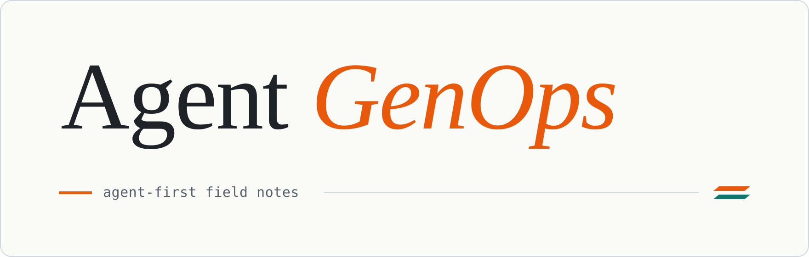
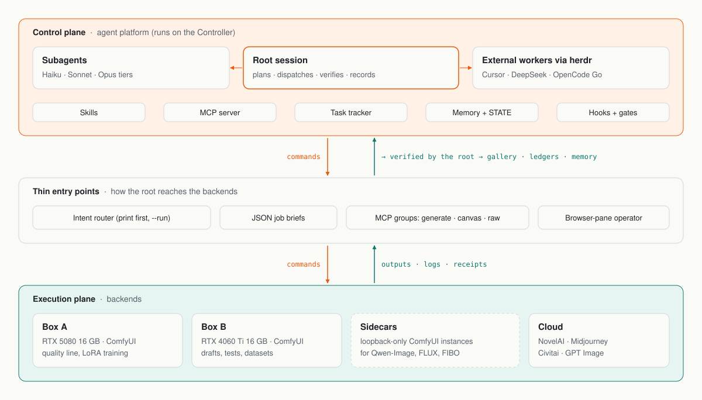
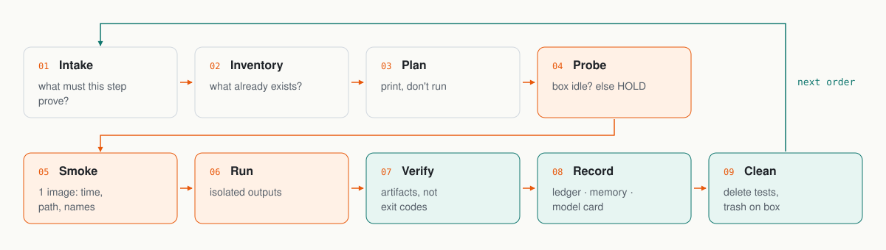

[English](README.md) | 中文

<p align="center">
  <picture>
    <source media="(prefers-color-scheme: dark)" srcset="assets/banner-dark.svg">
    
  </picture>
</p>

<p align="center">
  <a href="LICENSE"></a>
  <a href="README.md"></a>
  
</p>

# Agent GenOps

这是我用编码 agent 跑、调、部署本地图像和视频模型的方法。agent 负责规划、派工、验收和记录；ComfyUI 和云服务（NovelAI、Midjourney、Civitai、GPT Image）只负责出图。

它是一套工作方法，不是一个库。内容来自一套真实的环境：一台笔记本跑 agent，两张消费级显卡出图。每条规则背后的数字、日期和事故都留着。仓库里的 [skill](skills/agent-genops/) 可以让 agent 直接加载这套方法。

## 核心想法

<p align="center">
  <picture>
    <source media="(prefers-color-scheme: dark)" srcset="assets/architecture-dark.svg">
    
  </picture>
</p>

现在大多数做图像生成的 agent 工具，要么长在 ComfyUI 里面，要么作为桥接挂在它旁边。这个仓库把 agent 放在所有后端的上面：规划、派工、预算、验收、记忆都在 agent 平台上完成；ComfyUI 渲染机也好，云服务也好，都只是可以替换的执行器。

| agent 在哪里 | 能做什么 |
|---|---|
| 在 ComfyUI 里面（copilot 面板、图里的 LLM 节点） | 帮你搭或改一张图 |
| 在 ComfyUI 旁边（MCP 服务、桥接） | 提交工作流、列模型、取结果 |
| 在所有后端之上（这个仓库） | 在本地机器和云服务之间分配工作，交给更便宜的模型去做，管预算，验产物，记住学到的东西 |

[架构](docs/zh/01-architecture.md)一页列出了前两行对应的公开项目，并说明这里的做法差在哪。

## 每个任务走的流程

<p align="center">
  <picture>
    <source media="(prefers-color-scheme: dark)" srcset="assets/loop-dark.svg">
    
  </picture>
</p>

不管是一张测试图，还是上线一个新模型，都走同样的步骤：

1. **受理**：这一步要证明什么？
2. **盘点**：已经有什么（脚本、配方、模型、之前的结果）？
3. **计划**：先打印命令，不执行。
4. **探测**：机器空不空、模型在不在？不满足就 HOLD。
5. **smoke**：只出一张，核对单张耗时、输出路径、文件名。
6. **运行**：放整批，每个任务的产物单独存放。
7. **验收**：打开产物看；退出码和自述都不算数。
8. **记录**：记账、写记忆、更新模型卡。
9. **清理**：两边的测试图都删掉；用带日期的回收文件夹，不用系统回收站。

## 仓库里有什么

| 页面 | 回答什么问题 |
|---|---|
| [理念](docs/zh/00-philosophy.md) | 24 条工作规则，以及每条为什么存在 |
| [架构](docs/zh/01-architecture.md) | 控制面和执行面怎么接起来 |
| [环境](docs/zh/02-environment.md) | 参考硬件，以及什么活在哪台机器上跑 |
| [派工](docs/zh/03-dispatch.md) | 什么活交给哪一档模型；任务包；验收 |
| [模型上线](docs/zh/04-model-bringup.md) | 接入一个新模型或新运行时，从下载到定论 |
| [调试](docs/zh/05-debugging.md) | 症状、可能原因、先查什么；远程 Windows 的坑 |
| [出图纪律](docs/zh/06-render-discipline.md) | smoke、隔离落盘、队列、GPU 礼仪、清理 |
| [性能](docs/zh/07-performance.md) | A/B 方法、方差、量化和蒸馏的结论 |
| [库存管理](docs/zh/08-inventory.md) | 模型、LoRA、配方、产物、归档、账本 |
| [服务分工](docs/zh/09-providers.md) | 本地机器、NovelAI、Midjourney、Civitai、GPT Image |
| [提示词与评审](docs/zh/10-prompting-and-review.md) | 各模型的提示词规则、委托写提示词、记录审美的方法 |
| [安全与隐私](docs/zh/11-safety-and-privacy.md) | 受管出网、闸门、密钥、公私分离 |
| [记忆与交接](docs/zh/12-continuity.md) | 记忆文件、状态快照、交接、任务库 |
| [教训](docs/zh/13-lessons.md) | 带日期的事故，以及由此定下的规则 |

另外还有 [templates/](templates/)（任务包、模型卡、A/B 记录、出图单、交接、记忆条目、subagent 定义）和 [tools/](tools/)（这个仓库自己在用的隐私扫描工具）。

## 参考环境

| 机器 | 硬件 | 用途 |
|---|---|---|
| 控制机 | MacBook Air，Apple M5（10 核），24 GB | 跑 agent，不出图 |
| Box A | Windows，NVIDIA RTX 5080 16 GB，AMD Ryzen 7 9800X3D，约 48 GB 内存 | 质量线和 LoRA 训练。它也是仓库主人的游戏电脑，agent 要让路。2026-10-13 起空闲时也会睡眠 |
| Box B | Windows，NVIDIA RTX 4060 Ti 16 GB，32 GB 内存 | 草稿、测试、数据集。空闲时会睡眠 |
| Linux 节点 | 一对 NVIDIA DGX Spark（一台主节点加一台工作节点） | 批处理作业和模型服务 |

agent 这边：Claude Code，主会话用 Opus 5.5，subagent 用 Haiku、Sonnet、Opus；外部 worker 通过 [herdr](https://github.com/herdrdev/herdr) 调度（Cursor Composer 2.5、DeepSeek）；任务管理用 [bd（beads）](https://github.com/gastownhall/beads)。出图这边：两台机器都是 ComfyUI 0.42.1，新模型另开只监听本机的旁路实例。

## 使用 skill

skill 就是一个文件夹 [`skills/agent-genops/`](skills/agent-genops/)：一份 `SKILL.md`，加一个按需打开的 `references/` 目录。

在 Claude Code 里，这个仓库也可以直接当插件市场用。先添加市场，再装插件：

```text
/plugin marketplace add lepetitprince716-prog/agent-genops
/plugin install agent-genops@agent-genops
```

用别的 agent，或者想留一份本地副本，就克隆仓库，把这个文件夹链接到你的 agent 读取 skill 的位置。

```bash
git clone https://github.com/lepetitprince716-prog/agent-genops.git
```

```bash
ln -s "$PWD/agent-genops/skills/agent-genops" ~/.claude/skills/agent-genops
```

| agent | skill 目录 |
|---|---|
| Claude Code | `~/.claude/skills/`（或项目里的 `.claude/skills/`） |
| Codex | `~/.agents/skills/`（或项目里的 `.agents/skills/`） |
| Cursor | `~/.cursor/skills/` 或 `~/.agents/skills/` |
| Grok Build | `~/.grok/skills/`（或项目里的 `.grok/skills/`） |

skill 里只有方法。你自己的机器、入口和命令写在 `~/.config/agent-genops/LOCAL.md`，skill 发现它存在就会读，它永远不进这个仓库。要记哪些内容，可以参考 [templates/fleet.example.yaml](templates/fleet.example.yaml)。

## 派工速查

| 活 | 交给谁 |
|---|---|
| 大量阅读、信息提取、日志摘要、跑命令报结果 | Haiku worker |
| 需要综合多个来源的调研；Haiku 没做对时的重试 | Sonnet worker |
| 普通实现和调试 | Opus worker，medium |
| 多文件改动、设计判断、有契约要守的活 | Opus worker，high |
| 设计已经定好、只剩写代码；目标明确的长时间调优 | Sonnet worker，max |
| 计划执行前的审查 | plan reviewer |
| 提交前核对关于代码、测试、库的说法 | fact checker |
| 用其他厂商模型跑并行任务 | herdr worker（Cursor Composer、DeepSeek） |

一条线做到底的活留在主会话里。详见[派工](docs/zh/03-dispatch.md)。

## 保持仓库干净

这个仓库是公开的，提交历史里不能有个人信息。[`tools/privacy_scan.py`](tools/privacy_scan.py) 会检查局域网地址、用户目录路径、邮箱、密钥形态的字符串，以及图片里嵌着的生成参数。它挂在 git hook 和 CI 上。克隆后打开 hook：

```bash
git config core.hooksPath .githooks
```

你自己的私有规则（名字、主机名、域名）放在仓库外面的 `~/.config/agent-genops/private_rules.json`。详见 [PRIVACY.md](PRIVACY.md)。

## 状态

截至 2026 年 10 月的实战笔记。数字都来自同一套环境，标着日期、硬件和 ComfyUI 版本，当作数据点看，不要当成跑分。过期或没核实的内容，各页都会标出来。

## 参与和许可

欢迎提 issue 和 pull request，动手前请先读 [CONTRIBUTING.md](CONTRIBUTING.md)。代码和文档都采用 [MIT 许可](LICENSE)。
