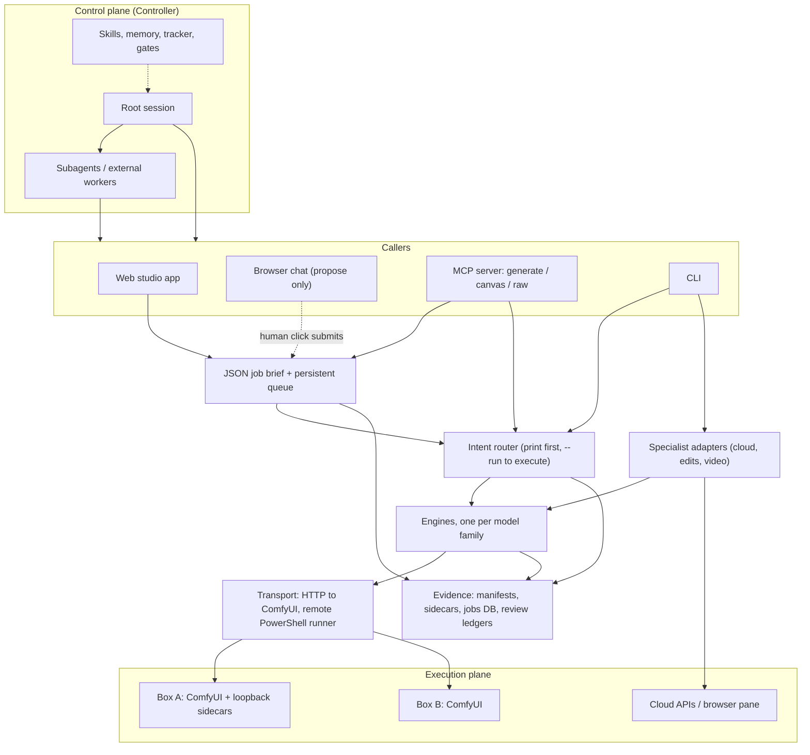

English | [中文](../zh/01-architecture.md)

# Architecture: control plane and execution plane

This page answers one question: where does work get planned, and where does it run?
In this setup the agent platform plans, dispatches, verifies and records. ComfyUI and the cloud
image services only execute. The page lays out both planes, the thin layers between them, and
why the ComfyUI canvas is something agents read but never queue from.

> **TL;DR**
> - Control plane: the root agent session, subagents, external workers, skills, MCP servers, a task tracker, memory files and gates. Nothing in it renders.
> - Execution plane: render boxes running ComfyUI from API-format graphs, loopback sidecar instances, cloud services, and browser-pane operators for sites with no API.
> - Every caller goes through one intent router that prints the plan by default and only executes with `--run`. Queued work enters as a JSON job brief.
> - One MCP server, three tool groups: generate, canvas, raw. The canvas group reads and patches the graph the owner has open; it never queues.
> - A script catalogue with a machine-checked registry stops agents from writing a fourth copy of a script that already exists.

## The two planes

**Control plane.** Everything that decides what to do, who does it, and whether it worked.

| Part | Role in this setup |
|---|---|
| Root session | One Claude Code session per task. Plans, dispatches, checks every worker result against the disk, writes the record. |
| Subagents | Claude models at fixed tiers (Haiku 5.5, Sonnet 5.5, Opus 5.5) launched by the root for bounded work. See `03-dispatch.md`. |
| External workers | Other vendors' agents driven through herdr: Cursor Composer 2.5 by default, DeepSeek off-peak, OpenCode Go at peak hours. Claude models never go through the multiplexer. |
| Skills | Runbooks an agent loads on demand: how to reach a box, how to run a line, how to hand off. |
| MCP servers | Typed tool surfaces over the execution plane. One server for ComfyUI work; a separate standalone server for NovelAI. |
| Task tracker | bd (beads). Answers "what, who took it, waiting on whom" across sessions. |
| Memory files | One fact per file plus an index, with dates. Snapshots are marked as snapshots. See `12-continuity.md`. |
| Hooks and gates | Root-owned hooks, a file gate, a shell gate, managed network wrappers. See `11-safety-and-privacy.md`. |

**Execution plane.** Everything that turns a plan into pixels or bytes.

| Part | What it is |
|---|---|
| Render boxes | Two Windows desktops running ComfyUI. Agents submit API-format graphs over HTTP and fetch outputs. See `02-environment.md`. |
| Sidecar instances | Extra ComfyUI instances on Box A that listen on loopback only, each pinned to its own ComfyUI version for one model line. Normally stopped. |
| Cloud services | NovelAI and Civitai through their APIs, under budgets and ledgers. See `09-providers.md`. |
| Browser-pane operators | A subagent that drives a site with no public API (Midjourney, ChatGPT web for GPT Image) in the app's built-in browser, one exact prompt at a time. |
| Linux node | An NVIDIA DGX Spark pair used for batch jobs and model services. Not part of the image lines here. |

The control plane holds the method; the execution plane is the part expected to change.

## The layers

Read it top to bottom:

1. **Callers** are entry surfaces: a web app, a browser chat, the MCP server, a shell. None of them holds a recipe.
2. **The intent router** (in my setup a script called `gen.py`) maps an intent plus uniform flags (`--prompt`, `--n`, `--seed`, `--lora`, `--box`) onto the right engine's real flags. Without `--run` it prints the command. `--list` prints the decision tree; `--route-json` writes a machine-readable plan; `--probe` is a readiness gate that exits 3 on HOLD. It starts engines as subprocesses and never imports them.
3. **Engines** are one per model family or line. They own the graph, the recipe and the per-box quirks.
4. **Transport** is the only code that talks to a box: HTTP to ComfyUI, and a remote PowerShell runner for anything on the Windows side.
5. **Boxes** run what they are given. Their live state is probed every time; documents never claim a box is online.
6. **Evidence** sits beside all of it: a per-run result manifest, sidecar JSON per image, the jobs database, review ledgers. A file existing is not acceptance.

Queued work takes a slightly different entry. A JSON job brief goes through one validation layer
shared by the web app and a one-JSON-in CLI (`gen_job.py`), lands in a persistent queue with an
idempotency key, and is turned into router arguments only at launch, when `--box auto` resolves
to a concrete box for that attempt. The browser chat agent has no submit tool: it proposes a
card, and only a human click submits it, with the proposal id as the idempotency key.

Specialist adapters (cloud APIs, instruction edits, video, exact-recipe replay) stay separate.
Their prompt dialect, runtime, cost and media semantics differ too much to fold into one planner.

## The MCP server and its three groups

One stdio server, registered once per agent host, with a CLI twin (`<launcher> call <tool> '{json}'`)
for agents that have no MCP support.

| Group | Tools (examples) | Contract |
|---|---|---|
| generate | `studio_generate`, `studio_job`, `media_ingest`, `image_generate`, `image_edit` | Product path. Goes through the queue and the router. Inputs are opaque ids, not host paths. |
| canvas | `comfy_selection`, `comfy_map`, `comfy_find`, `comfy_focus`, `comfy_patch`, `comfy_edit` | Reads and patches the graph open in the owner's ComfyUI browser tab through JSON files in ComfyUI's userdata store. No daemon. Never queues. |
| raw | `comfy_status`, `comfy_models`, `comfy_nodes`, `comfy_upload`, `comfy_run`, `comfy_history`, `comfy_fetch`, `comfy_cancel`, `comfy_free` | Direct ComfyUI access for analysis. `comfy_run` checks the box is idle first, refuses a busy box unless forced, and writes outputs only under an analysis folder. |

The tool count drifted across my own docs (17, 18, 19, 22 in four places). Count from the
server's own tool listing, not from prose.

## Rules

1. **The control plane renders nothing.**
   Why: standing rule. The Controller is a 24 GB laptop that runs the agents; GPU work goes to the boxes.

2. **Every caller goes through one router; no entry surface duplicates a recipe.**
   Why: standing rule from the project architecture (2026-08-28).

3. **Print first; execute only with `--run`.**
   Why: standing rule. The printed command is what the root compares against the brief before spending GPU time.

4. **Probe live state before every run; a valid plan does not prove the box is free.**
   Why: Box A is the owner's gaming PC. Resource plans are advisory; `--run` re-probes idle state and queue.

5. **New agent-facing ComfyUI capability goes into the existing server's raw group, not a new server.**
   Why: 2026-09-16. Three MCP servers with different interpreters each needed per-agent config, so none was registered anywhere. The tools worked; nobody could call them.

6. **Canvas tools never queue; a human presses Queue.**
   Why: standing rule. The queued path is where the idle check, the VRAM lease, the smoke-first rule and the evidence manifest live. A graph queued from the canvas skips all of them. The canvas also holds cached values that can be stale against the box's live model list, so names are validated before any submit.

7. **Queue failure is visible; it never falls back to direct execution silently.**
   Why: standing rule since the queue was wired in (2026-08-28): the facade never falls back silently, and direct execution needs an explicit opt-in.

8. **Subprocess anything that writes to stdout when stdout is the MCP wire.**
   Why: on stdio, a client library that prints or calls `SystemExit` corrupts the protocol. Generation shells out, and `comfy_run` moves the driver's log into a result field.

9. **Look up a script in the catalogue before writing one; borrow by copying.**
   Why: standing rule (2026-06-25). See the next section.

10. **Keep specialist lines as separate adapters; do not build a universal media framework.**
    Why: standing rule. Prompt dialects, runtimes and costs differ per line; a generic layer would hide exactly the differences that matter.

## The script catalogue

Without a catalogue, an agent asked to "render four variants" tends to write a new script
instead of finding the one that exists. The catalogue has three parts:

- **A human index** (one Markdown file at the repo root). Each entry: one line taken from the script's docstring, its default mode (plan or execute), its exit-code contract, what it refuses to do, its tests, and a pointer to the full recipe. Bold lead-ins mark where to start.
- **A machine registry** (one JSON file). Per script: status (`active`, `probe`, `legacy`, `test`, `reference`), zone, effects, targets, default mode, gates, timeout, output roots, cleanup, tests, authority. Status comes only from the registry, never from a filename or a file's age. CI rejects an unregistered script or an undeclared increase in risk.
- **A discovery order** for agents: router `--list` first, then the index, then the companion doc.

Borrowing policy: a borrower copies the script to scratch and edits the copy. Maintaining an
`active` script in place is a scoped engineering change; its path, CLI and output contract stay
frozen, and tests, registry and index move in the same commit. Existing risk counts in the
registry are a debt baseline, not permission to add more.

## How this differs from ComfyUI-centred tools

The public projects in this space mostly put the agent inside or beside ComfyUI. Here the agent
platform sits above several unlike backends, and ComfyUI is one of them. Landscape read on
2026-10-21:

| Project | Where the agent lives | Relation to this repo |
|---|---|---|
| [Comfy-Org/comfy-mcp](https://github.com/Comfy-Org/comfy-mcp) | Beside ComfyUI | First-party local MCP: run workflow, fetch outputs, validate, search nodes and models. It is the backend-adapter layer this repo treats as one tool among several. No tracker, no delegation policy. |
| [artokun/comfyui-mcp](https://github.com/artokun/comfyui-mcp) | Inside ComfyUI | MCP plus a sidebar agent inside ComfyUI. The opposite direction: ComfyUI is the hub and the agent is a feature of it. |
| [SlavaSexton/ComfyUI-Agent-Kit](https://github.com/SlavaSexton/ComfyUI-Agent-Kit) | Beside ComfyUI | One shared skill and MCP driver with thin adapters for several coding agents. Multi-agent, single backend. |
| [HuangYuChuh/ComfyUI_Skills_OpenClaw](https://github.com/HuangYuChuh/ComfyUI_Skills_OpenClaw) | Above one backend | Turns each workflow into a callable skill that exposes only chosen parameters. Closest to the "agents call a controlled interface, not raw graphs" rule here. |
| [Comfy Generation Manager](https://jaimemguajardo.com/blog/comfy-generation-manager/) (blog, 2026-07-31) | Above one backend | External Claude Code and Codex drive a manager through a small MCP: durable queue, job vs attempt, write tools need confirmation. Closest in method; no task tracker or delegation tiers. |

What none of them covers, as far as that search found: the agent platform as the stated control
plane over ComfyUI and cloud services at once, with subagent tiers, a task tracker and
cross-session budgets applied to generation work.

## Real cases

- **2026-09-16, "MCP as a flower vase".** I said the MCP could not stay a flower vase and had to work natively in every agent. Inventory: three MCP servers, three interpreters, registered for one agent or none. Fix: one server, one launcher, a CLI twin, registration per host done in one pass. Rule 5.
- **2026-09-17, release after every render.** The router freed VRAM after each image, so the next image of a burst reloaded checkpoint and LoRAs from disk. Replaced by a VRAM lease: models stay warm and an idle reaper frees the box after 300 s with an empty queue. The old "POST `/free` after every run" rule is obsolete.
- **Stdout on the wire, caught at design time.** The generation client prints and exits through `SystemExit`; importing its `main()` into the stdio server would have put both on the protocol stream. Generation runs in a subprocess instead. Rule 8.

## Tried and dropped

- **Several per-agent MCP servers.** Replaced on 2026-09-16 by one server. An older Node ComfyUI MCP is marked superseded.
- **"Second box first" routing** (2026-07-18). Replaced by probe-first: `--box auto` tries Box A and moves to Box B only when Box A is gaming, busy or unreachable.
- **Freeing VRAM after every render.** Replaced by the lease and reaper.
- **A universal planner for every line.** Not built, on purpose. Specialist adapters stay separate.
- **Two-box relay as the default chat route** (2026-08-23). Probably superseded by the MCP generate tool and per-line skills; not re-checked.

## See also

- `00-philosophy.md`: the principles behind the split.
- `02-environment.md`: the machines and what runs where.
- `03-dispatch.md`: subagent tiers and external workers.
- `06-render-discipline.md`: smoke first, isolation, the lease.
- `08-inventory.md`: the script catalogue and the model index.
- `11-safety-and-privacy.md`: gates and managed egress.
