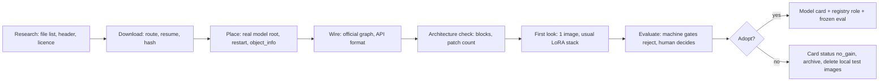

English | [中文](../zh/04-model-bringup.md)

# Model bring-up: adopting a new model or runtime

This page answers one question: how does a new checkpoint, quantized file, LoRA family or
ComfyUI runtime go from "someone posted it" to either "default in a recipe" or "archived as
no gain"? It covers research, download, verification, placement, sidecar runtimes, graph
wiring, architecture checks, the first look, evaluation freezing and the adopt-or-drop record.

> **TL;DR**
> - Decide from the repository file listing and the safetensors header, not from the README or the title.
> - Download over the fastest route that works today, resume on failure, then hash against the hub before installing.
> - Run a new runtime as a sidecar next to production until same-seed output matches; never upgrade production in place first.
> - Check block counts before attaching any LoRA or control weight. A mismatch does not raise an error; it produces scribbles.
> - Render one image per new model with the usual LoRA stack. Machine gates only reject; I decide. Write a model card either way.

## The lifecycle

## Rules

1. **Decide what to download from the repository file listing, not the model card.**
   Why: during the Qwen-Image speed round (2026-09-21) a model card described a whole family
   of mixed-precision GGUF files and recommended a tier. None of those files were in the
   repository.

2. **Read the safetensors header before trusting any label.**
   Why: a Civitai version titled "FP8" was really INT8 (12.8 GB); the true fp8 file was a
   non-primary 22.2 GB download. The header also gives tensor count, block count and
   parameter count: a community Anima checkpoint turned out to be 28 blocks and 2.09B
   parameters, not the 2.9B it was assumed to be (2026-09-02), and a merge with "ANIMA" in its
   name was an SDXL model.

3. **Research fast-moving models with an adversarial pass over the numbers.**
   Why: a base-model training survey ran 12 parallel web research units, then checked 139
   numeric claims adversarially. 20 were corrected. The correction table wins over any
   earlier figure.

4. **Find the real model root by locating a known model file.**
   Why: on Box A the root ComfyUI reads is not the default `models` directory, and there are
   two model roots on two drives. Guessing the directory puts weights where nothing loads them.

5. **Verify every download by sha256 against the hub before it goes into a model directory.**
   Why: aria2's checksum flag gets mangled when passed through PowerShell (2026-10-20), so the
   hash is checked after the download with `Get-FileHash`. Model directories are scanned
   dynamically, so a half-finished file shows up in the model list and fails at load time.
   Community nodes are pinned by commit for the same reason.

6. **Restart the server after adding weights or nodes, and prove the restart happened.**
   Why: `object_info` is built at start. On 2026-07-02 the Box A service "restart" returned in
   0.5 s while the Python process kept running, because the stop did not kill the process tree.
   Prove it with the process start time or a new node appearing in `object_info`.

7. **Run a new runtime as a sidecar beside production, with its own root and node whitelist.**
   Why: Qwen-Image 2.1 needed ComfyUI 0.37.0 while production was on 0.33.1. The sidecar
   listens on loopback only, has a private base directory and a custom-node whitelist, never
   loads production's extra-model-paths file, and is started through WMI process creation so
   it survives the SSH session. Trap found on 2026-10-19: the sidecar venv inherits the
   production venv, so upgrading production in place silently changes the sidecar too.

8. **Upgrade production by cloning the venv and comparing same-seed output on a sibling instance.**
   Why: the 0.42.1 trial (2026-10-19) cloned the production venv and installed only the three
   wheels 0.42.1 pins. Results: SDXL-class output pixel-identical, Anima PSNR 28 to 37 dB with
   unchanged composition, warm speed equal, cold start 2.4 to 4.2 s slower on light recipes,
   Qwen 2.1 pixel-identical between the 0.37.0 sidecar and 0.42.1. 0.42.1 migrates the UI
   database to a revision 0.33.1 cannot open, so the database is backed up before the switch.
   Both render boxes run 0.42.1 since 2026-10-20.

9. **Wire graphs from the official reference workflow, never from memory.**
   Why: Anima's official wiring is UNETLoader, CLIPLoader with type `stable_diffusion` and the
   0.6B text encoder, and the Qwen-Image VAE, with no clip-skip node. On 2026-06-25 a txt2img
   graph went out with denoise 0.5 and produced three "findings" (among them: baked VAE washes
   out, base over-exposes) that were all later retracted. Experiment parameters are read from the graph
   embedded in the output PNG.

10. **Check block counts before attaching a LoRA or control weight.**
    Why: Anima grew from 28 blocks (2B) to 40 (2.9B) to 52 (3.8B) by layer insertion. A
    28-block LoRA on the 52-block model draws scribbles with no error. Core LLLite control
    patches by block index with no remap, so a 28-block weight on a 40-block base silently
    misaligns. The check is a patch-count identity: patches equal LoRA tensors divided by 3
    (840 tensors, 280 patches). Zero patches means the key dialect or the remap table is wrong.

11. **Use strength 0.001, not 0, for a LoRA control arm.**
    Why: ComfyUI short-circuits strength 0 and returns the model untouched. A zero-strength
    arm proves nothing, and a LoRA that was silently ignored reads as "compatible".

12. **Render one image per new model, with my usual LoRA stack, before any matrix.**
    Why: on 2026-09-15 a 24-cell bare-model matrix cost my attention and gave the verdict
    "no clear gain, bare styles too different to compare". I always render with LoRAs, so a
    bare comparison answers a question nobody asked. Ask "compare with the usual stack?" first.

13. **Machine gates eliminate; human eyes decide.**
    Why: in the first bench round three cards passed 22, 16 and 16 of 24 gate checks, and the
    verdict still came from the contact sheet. On 2026-08-04 a face-shape collapse passed 10/10
    identity checks and zero QC flags; only a human caught it.

14. **Do not reuse a purpose-built eval script as a cross-model bench.**
    Why: a continued-pretraining eval script hard-coded its prompts, its rating levels and a
    latent node name. Every 40-block card used a different latent node and was rejected at
    scoring.

15. **Freeze the evaluation engine by hash, and repin in the same commit that changes it.**
    Why: an eval bank pins the fast-line engine's sha256. Changing one byte fails 31 tests.
    Once real evaluation images exist, a repin makes old evidence incomparable, so it needs my
    consent first.

16. **Adopt or drop through a model card and a registry role, never a hard-coded name.**
    Why: in 2026-09 the default Anima base was defined in three independent places. Scripts now
    resolve a role such as `quality_default` from the registry. Cards judged no-gain are
    archived to cold storage and their local test images deleted.

## Procedure: bring up one model

1. Read the repository file list, the licence and the safetensors header (tensor dtype, block
   count, parameters). Note release date and the author's recommended steps, CFG and sampler.
2. Pick the download route (table below), download with resume, hash against the hub.
3. Place the file under the real model root, restart the server, confirm the name in
   `object_info`.
4. Build the graph from the official workflow. Submit it in API format; read results back.
5. Run the architecture check: block count against the LoRA and control weights you intend to
   use; patch count equals tensors / 3.
6. Render one smoke image. Check time per image, write path and filename rule before anything
   bigger (see [`06-render-discipline.md`](06-render-discipline.md)).
7. Render one image with the usual LoRA stack, same prompt and seed as the current default.
8. Let gates reject broken output. Put the survivors in front of me on one review page.
9. Write the model card ([`templates/model-card.md`](../../templates/model-card.md)): strengths, weaknesses, prompt
   rules, recipe, warm speed with date and ComfyUI version, traps, verdict.
10. Adopted: set the registry role, freeze the eval engine, register recipes by name.
    Dropped: status `no_gain`, archive, delete local test images, keep the lesson.

## Download practice

Routes measured from Box A. Speeds change week to week; re-measure before a large pull.

| Route | Speed | Date | Notes |
|---|---|---|---|
| Local forward proxy to Hugging Face | 45 to 55 MB/s | 2026-07-13 | Later unusable (no listener, TLS EOF) |
| Same proxy route | 0.5 MB/s | 2026-09-30 | Degraded |
| Hugging Face mirror, plain tools | 1.0 to 2.4 MB/s | 2026-09-30 | Fallback only |
| ModelScope direct | 16 to 19 MB/s | 2026-09-30 | Check for a mirror of the same repo first |
| Hugging Face mirror + aria2, 8 connections | about 55 MiB/s | 2026-10-20/21 | Current main fallback |

- [ ] Behind a proxy, disable XET; the hub library can hang at 0 bytes, so use a plain HTTP
      Range downloader with resume.
- [ ] Watch aria2's own counters, not the file length (it preallocates).
- [ ] Measure progress with `os.walk`; glob skips the hub's hidden cache directories.
- [ ] Stopping the local wrapper call does not stop the remote download. Find the remote
      process by command line and kill it by pid.
- [ ] A mirror snapshot install: read the repo sha from the mirror API, download each file
      into the snapshot path for that sha, write `refs/main`. Never send a hub token to a
      mirror. Python 3.9's urllib does not follow 308 redirects; use 3.11+.
- [ ] A LoRA manager's download endpoint blocks until the file is done and the proxy drops the
      connection after a few minutes while the download continues. Poll the progress endpoint;
      if the percentage stalls, pause then resume (a 95% stall recovered at 12 MB/s on
      2026-09-29).
- [ ] Python packages on boxes with slow PyPI: one mirror missed new packages; the Aliyun
      mirror installed 8 packages in 38 s (2026-10-20).

## Sidecar or main server

| Question | Main server | Sidecar |
|---|---|---|
| Model needs a newer core than production | No | Yes |
| Must not disturb jobs others depend on | No | Yes |
| Custom nodes untested with production | No | Yes, behind a whitelist |
| Same-seed output already matches production version | Yes, merge back | No longer needed |

A sidecar shares the 16 GB GPU with the main server. Free VRAM on the main server before a
sidecar run. Sidecars stay stopped when idle. Stop one by matching its command line (port and
private root) before killing; never kill by image name.

## Real cases

- **2026-09-15, bare-model matrix.** 24 cells across new 28-block cards, then a quality-tier
  look at four more. Verdict: no clear gain for any of them.
  Rule: one image per model, with the usual stack (rule 12).
- **2026-09-17, 52-block remap.** No official 40→52 manifest existed. Derived one by per-block
  cosine between the earliest native 40-block checkpoint and the 52-block one, on two
  independent probe weights. Both probes agreed on all 52 blocks; native blocks matched at
  cosine 0.9995 to 1.0002, the 12 inserted blocks matched their previous neighbour at 0.943 to
  0.986, at every fourth position from 3. A remapped 28-block LoRA on the mxfp8 model attached
  280/280 patches and sampled in 16.295 s against 16.271 s without it (Box A, ComfyUI 0.33.1
  libraries). Rule: rule 10.
- **2026-09-18, LoRA on a partially loaded INT8 ConvRot checkpoint.** 6/6 crashed on unpatch
  and leaked about 11 GB of VRAM that `/free` could not recover; only a service stop and start
  did. A fully loaded int4 ConvRot file took the same LoRA 7/7. Rule: the variable is "partially
  loaded", not the quant format; test LoRA attachment before adoption.
- **2026-09-30, LoRA extracted from a model difference.** The save step wrote 156 1-D norm
  weights as "minus base", which is pure noise when attached. Rule: inspect the difference
  tensors after any extraction.
- **2026-10-21, publishing a speed-up.** The 3.8B speed-up came from weight format, an
  attention backend, fused kernels and a resident process, so it cannot ship as a LoRA. The
  mxfp8 file had only ever run inside a custom worker, never in a normal ComfyUI GUI, and was
  baked from v1.0 while upstream had moved to v1.1. Rule: a GUI load check and a version
  decision come before any release.

## Tried and dropped

- Bare-model matrices for new checkpoints (2026-09-15).
- A purpose-built continued-pretraining eval script as a cross-model bench.
- Uncalibrated nvfp4 baking: 1.65x faster, quality collapsed (details in [`07-performance.md`](07-performance.md)).
- The Krea-2 line: dropped on 2026-10-13 after a three-way anime comparison I judged in favour
  of Qwen-Image 2.1; its base models went to a quarantine folder.
- A video model's quantized release that existed only as NVFP4 on Civitai and was broken in
  ComfyUI.

## See also

- [`05-debugging.md`](05-debugging.md): when a new model loads but renders wrong.
- [`06-render-discipline.md`](06-render-discipline.md): smoke before batch, isolation, cleanup.
- [`07-performance.md`](07-performance.md): quantization and distillation verdicts.
- [`08-inventory.md`](08-inventory.md): registries, model index, archive.
- [`10-prompting-and-review.md`](10-prompting-and-review.md): prompt rules per family, review method.
