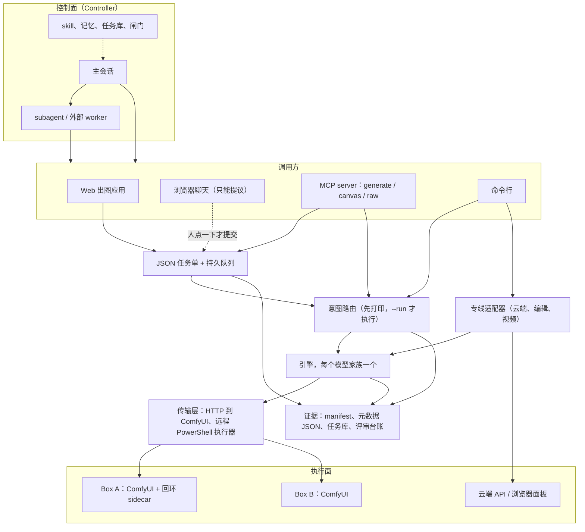

[English](../en/01-architecture.md) | 中文

# 架构：控制面与执行面

这页回答一个问题：活在哪里定，又在哪里跑？
我的做法是让 agent 平台负责计划、派工、验收和记账，ComfyUI 和各家云端出图服务只管执行。
下面讲两个面各有什么、中间那几层薄入口怎么叠，以及为什么 agent 可以读 ComfyUI 画布，却从不在画布上排队。

> **TL;DR**
> - 控制面：主会话、subagent、外部 worker、skill、MCP server、任务库、记忆文件、闸门。它不出一张图。
> - 执行面：用 API 格式工作流跑 ComfyUI 的渲染机、只听回环的 sidecar 实例、云端服务，以及给没有 API 的网站用的浏览器面板操作员。
> - 所有入口都走同一个意图路由：默认只打印计划，加 `--run` 才执行。排队的活用 JSON 任务单进来。
> - 一个 MCP server，三组工具：generate、canvas、raw。canvas 组读、改我在浏览器里开着的工作流，从不排队。
> - 脚本目录加机器可校验的注册表，挡住 agent 给已有脚本再写第四份。

## 两个面

**控制面**：决定做什么、谁来做、做成没有。

| 组成 | 在我这里干什么 |
|---|---|
| 主会话 | 每个任务一个 Claude Code 会话。定计划、派工、拿磁盘核对每个 worker 的结果、写记录。 |
| subagent | 主会话按固定档位起的 Claude 模型（Haiku 5.5、Sonnet 5.5、Opus 5.5），做有边界的活。见 [`03-dispatch.md`](03-dispatch.md)。 |
| 外部 worker | 经 herdr 驱动的别家 agent：默认 Cursor Composer 2.5，错峰用 DeepSeek，高峰期换 OpenCode Go。Claude 模型从不走多路复用器。 |
| skill | 按需加载的操作手册：怎么连机器、怎么跑某条线、怎么交接。 |
| MCP server | 执行面上的带类型工具层。ComfyUI 一个 server，NovelAI 另起一个独立 server。 |
| 任务库 | bd（beads）。跨会话回答「做什么、谁领了、在等谁」。 |
| 记忆文件 | 一个事实一个文件，外加索引，带日期。快照标明是快照。见 [`12-continuity.md`](12-continuity.md)。 |
| hook 与闸门 | root 所有的 hook、文件闸、shell 闸、受管网络 wrapper。见 [`11-safety-and-privacy.md`](11-safety-and-privacy.md)。 |

**执行面**：把计划变成像素和字节。

| 组成 | 是什么 |
|---|---|
| 渲染机 | 两台跑 ComfyUI 的 Windows 台式机。agent 通过 HTTP 提交 API 格式工作流，再取回输出。见 [`02-environment.md`](02-environment.md)。 |
| sidecar 实例 | Box A 上额外的 ComfyUI 实例，只听回环，每个钉一个 ComfyUI 版本、服务一条模型线，平时停着。 |
| 云端服务 | NovelAI 和 Civitai 走 API，有预算、有台账。见 [`09-providers.md`](09-providers.md)。 |
| 浏览器面板操作员 | 一个 subagent，在 app 内置浏览器里操作没有公开 API 的网站（Midjourney、给 GPT Image 用的 ChatGPT 网页），一次提交一条原样提示词。 |
| Linux 节点 | 一对 NVIDIA DGX Spark（头节点加一个工作节点），跑批处理作业和模型服务。不在这里讲的出图线里。 |

方法放在控制面，执行面是预期会换的那部分。

## 分层

从上往下读：

1. **调用方**是各个入口：Web 应用、浏览器聊天、MCP server、shell。它们都不存配方。
2. **意图路由**（我这里是一个叫 `gen.py` 的脚本）把意图和统一参数（`--prompt`、`--n`、`--seed`、`--lora`、`--box`）翻成具体引擎的真实参数。不加 `--run` 就只打印命令。`--list` 打印决策树，`--route-json` 写出机器可读的计划，`--probe` 是就绪闸，HOLD 时退出码 3。它用子进程起引擎，从不 import 引擎。
3. **引擎**按模型家族或出图线分，一线一个。工作流、配方、每台机器的小毛病都归引擎管。
4. **传输层**是唯一跟机器说话的代码：HTTP 连 ComfyUI，Windows 那边的事交给远程 PowerShell 执行器。
5. **机器**只跑交给它的活。每次都现场探活，文档从不声称哪台机器在线。
6. **证据**挨着每一层：每次运行一份结果 manifest，每张图一份 元数据 JSON，任务数据库，评审台账。文件存在不等于验收通过。

排队的活入口稍有不同。JSON 任务单先过一层校验，Web 应用和单 JSON 入口的命令行（`gen_job.py`）共用这层；然后带着幂等键进持久队列，等真正启动时才翻成路由参数，`--box auto` 也是这时才落到这次尝试的具体机器上。浏览器聊天里的 agent 没有提交工具：它只能生成一张提议卡，人点一下才提交，提议 id 就是幂等键。

专线适配器（云端 API、指令编辑、视频、原配方复刻）单独放。它们的提示词方言、运行时、花费和媒体语义差太多，塞进一个通用规划器只会把差别藏起来。

## MCP server 的三组工具

一个 stdio server，每个 agent 宿主注册一次；没有 MCP 支持的 agent 用同名命令行（`<launcher> call <tool> '{json}'`）。

| 组 | 工具举例 | 约定 |
|---|---|---|
| generate | `studio_generate`、`studio_job`、`media_ingest`、`image_generate`、`image_edit` | 成品出图路径。走队列和路由。输入是不透明 id，不是机器上的路径。 |
| canvas | `comfy_selection`、`comfy_map`、`comfy_find`、`comfy_focus`、`comfy_patch`、`comfy_edit` | 通过 ComfyUI userdata 里的 JSON 文件读、改我浏览器里开着的工作流。没有常驻进程。从不排队。 |
| raw | `comfy_status`、`comfy_models`、`comfy_nodes`、`comfy_upload`、`comfy_run`、`comfy_history`、`comfy_fetch`、`comfy_cancel`、`comfy_free` | 直连 ComfyUI，给分析用。`comfy_run` 先查机器是否空闲，忙就拒绝（除非强制），输出只写进分析目录。 |

工具数量在我自己的几份文档里写成了 17、18、19、22 四个数。以 server 自己列出的工具清单为准，别信文字。

## 规则

1. **控制面不出图。**
   理由：仓库主人的决定。Controller 是一台 24 GB 的笔记本，跑 agent；GPU 活交给渲染机。

2. **所有入口走同一个路由，哪个入口都不复制配方。**
   理由：项目架构文档里的固定规则（2026-08-28）。

3. **先打印，加 `--run` 才执行。**
   理由：仓库主人的决定。主会话拿打印出来的命令和任务单对一遍，再花 GPU 时间。

4. **每次运行前现场探活；计划合法不代表机器空着。**
   理由：Box A 是我的游戏机。资源计划只是建议，`--run` 会重新探空闲和队列。

5. **新的、面向 agent 的 ComfyUI 能力加进现有 server 的 raw 组，不另开 server。**
   理由：2026-09-16。当时有三个 MCP server，解释器各不相同，每家 agent 都要单独配，结果谁都没配上。工具本身能用，就是没人调得到。

6. **canvas 工具从不排队，Queue 由人来按。**
   理由：仓库主人的决定。空闲检查、显存租约、先跑一张 smoke、证据 manifest，全在排队那条路上。从画布直接排队会把这些全绕过去。画布里还存着缓存值，可能跟机器上实时的模型清单对不上，所以提交前要先校验模型名。

7. **队列失败要看得见，不许悄悄退回直接执行。**
   理由：2026-08-28 接入队列时定下的固定规则：门面层从不悄悄回退，直接执行要显式打开环境变量。

8. **stdout 就是 MCP 线路时，凡是会往 stdout 写东西的代码都放进子进程。**
   理由：stdio 模式下，客户端库一打印或者调 `SystemExit`，协议就坏了。出图改成起子进程，`comfy_run` 把驱动日志挪进结果字段。

9. **写脚本之前先查目录；借用就复制一份。**
   理由：仓库主人的决定（2026-06-25）。见下一节。

10. **专线保持独立适配器，不造通用媒体框架。**
    理由：仓库主人的决定。各线的提示词方言、运行时、花费都不一样，通用层恰好会把要紧的差别盖住。

## 脚本目录

没有目录，agent 接到「出四张变体」，往往会新写一个脚本，而不是找到现成的那个。目录分三块：

- **给人看的索引**（仓库根目录一个 Markdown 文件）。每条写：从 docstring 摘的一句话、默认模式（只计划还是直接执行）、退出码约定、它拒绝做什么、对应测试、完整配方在哪。加粗的开头标出从哪里入手。
- **机器注册表**（一个 JSON 文件）。每个脚本记：状态（`active`、`probe`、`legacy`、`test`、`reference`）、区域、副作用、目标、默认模式、闸门、超时、输出根目录、清理方式、测试、权威文档。状态只认注册表，不按文件名或新旧猜。CI 拒收没登记的脚本，也拒收没申报的风险增加。
- **agent 的查找顺序**：先路由的 `--list`，再索引，再配套文档。

借用规则：借的人把脚本复制到草稿目录改副本。原地维护一个 `active` 脚本算一次有范围的工程改动，路径、命令行和输出约定冻结不动，测试、注册表、索引在同一个 commit 里一起改。注册表里已有的风险计数是欠账基线，不是可以照着再加的许可。

## 跟以 ComfyUI 为中心的工具有什么不同

这个领域的公开项目，多数把 agent 放进 ComfyUI 里面，或者放在它旁边。我这里的 agent 平台压在好几种不同后端上面，ComfyUI 只是里面的一个。下表是 2026-10-21 查的：

| 项目 | agent 在哪 | 跟本仓库的关系 |
|---|---|---|
| [Comfy-Org/comfy-mcp](https://github.com/Comfy-Org/comfy-mcp) | ComfyUI 旁边 | 官方本地 MCP：跑工作流、取输出、校验、搜节点和模型。它就是本仓库当作「众多工具之一」的那层后端适配。没有任务库，也没有派工规则。 |
| [artokun/comfyui-mcp](https://github.com/artokun/comfyui-mcp) | ComfyUI 里面 | MCP 加 ComfyUI 内的侧栏 agent。方向正好相反：ComfyUI 是中心，agent 是它的一个功能。 |
| [SlavaSexton/ComfyUI-Agent-Kit](https://github.com/SlavaSexton/ComfyUI-Agent-Kit) | ComfyUI 旁边 | 一份共享 skill 加 MCP 驱动，给几家编码 agent 各配一层薄适配。多 agent，单后端。 |
| [HuangYuChuh/ComfyUI_Skills_OpenClaw](https://github.com/HuangYuChuh/ComfyUI_Skills_OpenClaw) | 一个后端之上 | 把每个工作流变成可调用的 skill，只暴露选定参数。跟我这里「agent 调受控接口，不碰原始工作流」最接近。 |
| [Comfy Generation Manager](https://jaimemguajardo.com/blog/comfy-generation-manager/)（博客，2026-07-31） | 一个后端之上 | 外部的 Claude Code、Codex 经一个小 MCP 操作管理器：持久队列、job 与 attempt 分开、写操作要确认。方法上最近，但没有任务库和派工档位。 |

那次搜索没找到的：把 agent 平台明确当成控制面，同时管 ComfyUI 和云端服务，再把 subagent 档位、任务库、跨会话预算用到出图上。

## 真实案例

- **2026-09-16，「MCP 成了花瓶」。** 我说 MCP 不能是花瓶，要原生适配各家 agent。一查：三个 MCP server，三种解释器，要么只给一家注册，要么谁都没注册。改法：一个 server、一个启动器、一个同名命令行，各宿主一次注册完。对应规则 5。
- **2026-09-17，每张图都释放显存。** 路由每出一张就释放显存，连拍时下一张要从磁盘重新加载 checkpoint 和 LoRA。改成显存租约：模型常驻，队列空且闲置 300 s 后由回收器释放。旧规矩「每次跑完都 POST `/free`」作废。
- **stdout 混进线路，设计阶段就拦下了。** 出图客户端会打印，也会走 `SystemExit` 退出；要是把它的 `main()` 直接 import 进 stdio server，这两样都会混进协议流。所以出图放在子进程里跑。对应规则 8。

## 试过又放弃的

- **每家 agent 一个 MCP server。** 2026-09-16 换成一个 server。旧的 Node 版 ComfyUI MCP 标为已取代。
- **「先上第二台机器」的路由**（2026-07-18）。换成先探：`--box auto` 先试 Box A，Box A 在玩游戏、忙或连不上才转 Box B。
- **每出一张就释放显存。** 换成租约加回收器。
- **一个通吃所有线的规划器。** 故意没做，专线保持独立。
- **双机接力当聊天出图的默认路线**（2026-08-23）。大概率已被 MCP 的 generate 工具和各线 skill 取代，没复核。

## 另见

- [`00-philosophy.md`](00-philosophy.md)：这样分面背后的原则。
- [`02-environment.md`](02-environment.md)：机器，以及什么跑在哪。
- [`03-dispatch.md`](03-dispatch.md)：subagent 档位和外部 worker。
- [`06-render-discipline.md`](06-render-discipline.md)：先跑 smoke、隔离落盘、显存租约。
- [`08-inventory.md`](08-inventory.md)：脚本目录和模型索引。
- [`11-safety-and-privacy.md`](11-safety-and-privacy.md)：闸门和受管出网。
