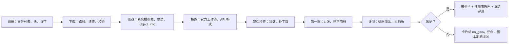

[English](../en/04-model-bringup.md) | 中文

# 模型上线：从下载到采纳或放弃

这页回答一个问题：一个新 checkpoint、量化文件、LoRA 系列或新版 ComfyUI 运行时，
怎么从「有人发出来了」走到「写进配方当默认」或者「标成无提升归档」？
覆盖调研、下载、校验、落盘、sidecar 运行时、接图、架构检查、第一眼、评测冻结和采纳记录。

> **TL;DR**
> - 看仓库文件列表和 safetensors 头做决定，不看 README，也不看标题。
> - 走今天最快的那条下载路线，断了就续传，装之前对 hub 核 sha256。
> - 新运行时先当 sidecar 跑在生产旁边，同 seed 输出对上之前，生产不原地升级。
> - 挂 LoRA 或控制权重之前先核块数。块数不对不报错，只出涂鸦。
> - 新模型每个只出一张，挂常用 LoRA 栈出。机器门只负责淘汰，拍板的是我。不管留不留，都写模型卡。

## 生命周期

## 规则

1. **下什么看仓库文件列表，不看模型卡。**
   理由：2026-09-21 Qwen-Image 提速轮，有张模型卡详细介绍了一整套混精度 GGUF，还给了推荐档，
   仓库里一个都没有。

2. **任何标签都先读 safetensors 头再信。**
   理由：Civitai 上一个标题写「FP8」的版本，主文件其实是 INT8（12.8 GB），真正的 fp8 是另一个
   22.2 GB 的非主文件。头里还有张量数、块数、参数量：一个社区 Anima checkpoint
   原以为是 2.9B，读头发现是 28 块、2.09B（2026-09-02）；另一个名字里带「ANIMA」的合并模型
   实际是 SDXL。

3. **变化快的模型，调研完要对数字做一轮对抗核查。**
   理由：一次底模训练调研开了 12 路并行搜索，再对 139 条数字结论逐条对抗核查，改掉 20 条。
   数字冲突时以订正表为准。

4. **真实模型根靠找一个已知文件来定。**
   理由：Box A 上 ComfyUI 实际读的根不是默认的 `models` 目录，而且两块盘上各有一个模型根。
   凭猜放进去，权重放了也加载不到。

5. **每个下载都对 hub 核 sha256，再放进模型目录。**
   理由：aria2 的校验参数经过 PowerShell 就坏了（2026-10-20），所以下完再用 `Get-FileHash` 核。
   模型目录是动态扫描的，没下完的文件也会出现在列表里，到加载时才炸。
   社区节点按 commit 钉死，道理相同。

6. **加了权重或节点就重启服务，并且证明真的重启了。**
   理由：`object_info` 是启动时建的。2026-07-02 Box A 的服务「重启」0.5 秒就返回，Python 进程
   其实一直活着，因为停服务没杀进程树。用进程启动时间，或者 `object_info` 里出现新节点来证明。

7. **新运行时当 sidecar 跑在生产旁边，私有根目录，自定义节点走白名单。**
   理由：Qwen-Image 2.1 要 ComfyUI 0.37.0，生产当时是 0.33.1。sidecar 只听回环，有自己的
   base 目录和节点白名单，绝不加载生产的 extra-model-paths 文件，用 WMI 进程创建拉起，
   这样 SSH 断了它还活着。2026-10-19 发现的坑：sidecar 的 venv 叠在生产 venv 上，原地升级生产
   会顺带改掉 sidecar。

8. **升级生产：先克隆 venv，在并排实例上比同 seed 输出。**
   理由：0.42.1 试装（2026-10-19）克隆了生产 venv，只往克隆里装 0.42.1 钉死的三个 wheel。
   结果：SDXL 系逐像素相同；Anima PSNR 28–37 dB，构图不变；热态同速；轻配方冷启动慢
   2.4–4.2 秒；Qwen 2.1 在 0.37.0 sidecar 和 0.42.1 上逐像素相同。0.42.1 会把界面数据库迁到
   0.33.1 打不开的版本，所以切换前先备份数据库。2026-10-20 起两台出图机都是 0.42.1。

9. **按官方参考工作流接图，不凭记忆。**
   理由：Anima 官方接法是 UNETLoader、CLIPLoader（type `stable_diffusion`，0.6B 文本编码器）、
   Qwen-Image VAE，不接 clip-skip。2026-06-25 一张 txt2img 图带着 denoise 0.5 提交出去，
   得出三条「发现」（其中有「内置 VAE 发灰」「底模过曝」），后来全部撤回。实验参数一律从成图 PNG
   内嵌的图谱里读。

10. **挂 LoRA 或控制权重之前先核块数。**
    理由：Anima 靠插层从 28 块（2B）长到 40 块（2.9B）再到 52 块（3.8B）。28 块 LoRA 挂到
    52 块模型上直接出涂鸦，不报错。核心 LLLite 控制按块下标打补丁、不做重映射，28 块权重
    挂 40 块底模会静默错位。检查办法是补丁数恒等式：补丁数 = LoRA 张量数 ÷ 3（840 个张量
    对应 280 个补丁）。补丁数为 0，说明键方言或映射表错了。

11. **LoRA 对照臂用强度 0.001，不用 0。**
    理由：ComfyUI 对强度 0 直接短路，原样返回模型。0 强度臂什么都证明不了，LoRA 静默没生效
    也会读成「兼容」。

12. **新模型每个先出一张，挂我常用的 LoRA 栈，再谈矩阵。**
    理由：2026-09-15 铺了一张 24 格裸模矩阵，白占了我的注意力，结论是「没有明显提升，
    裸模画风差太多，没法比」。我出图总是挂 LoRA，裸模横比回答的是没人问的问题。
    动手前先问一句「要不要挂常用栈比」。

13. **机器门只淘汰，拍板靠人眼。**
    理由：第一轮测试台三张卡门检分别过了 24 格里的 22、16、16 格，结论还是看 contact sheet
    定的。2026-08-04 一次脸型崩坏通过了 10/10 身份检查、零 QC 标记，只有人眼看出来。

14. **专用评测框架不要拿来横比模型。**
    理由：一个继续预训练用的评测框架写死了提示词、评级档和一个 latent 节点名。40 块的卡用的
    是另一个 latent 节点，在打分阶段全部打回。

15. **评测引擎按哈希冻结，改引擎的同一个提交里重新钉。**
    理由：评测库钉住了快线引擎的 sha256，改一个字节就挂 31 条测试。一旦已经出了正式评测图，
    重新钉会让旧证据对不上，所以要先问我。

16. **采纳或放弃都落到模型卡和注册表角色上，不写死模型名。**
    理由：2026-09 时 Anima 默认底模在三个地方各定义了一份。现在脚本从注册表解析
    `quality_default` 这类角色。判为无提升的卡归档到冷存储，本地测试图删掉。

## 流程：上线一个模型

1. 读仓库文件列表、许可、safetensors 头（张量 dtype、块数、参数量），记下发布日期和作者推荐的
   步数、CFG、采样器。
2. 按下表选下载路线，带续传下载，对 hub 核哈希。
3. 放进真实模型根，重启服务，在 `object_info` 里确认名字。
4. 按官方工作流搭图，用 API 格式提交，结果读回来。
5. 架构检查：块数对上打算用的 LoRA 和控制权重；补丁数 = 张量数 ÷ 3。
6. 出一张 smoke：放大批量之前先核单张耗时、落盘路径、文件名规则（见 [`06-render-discipline.md`](06-render-discipline.md)）。
7. 挂常用 LoRA 栈出一张，提示词和 seed 跟现行默认一致。
8. 机器门先筛掉坏图，剩下的放进一个评审页给我看。
9. 写模型卡（[`templates/model-card.md`](../../templates/model-card.md)）：长处、短处、提示词规则、配方、热态速度（带日期和
   ComfyUI 版本）、坑、结论。
10. 采纳：设注册表角色，冻结评测引擎，配方按名字注册。
    放弃：状态标 `no_gain`，归档，删本地测试图，教训留下。

## 下载

以下速度都是在 Box A 上量的。速度一周一个样，大文件开下前重新测。

| 路线 | 速度 | 日期 | 备注 |
|---|---|---|---|
| 本机正向代理直连 Hugging Face | 45–55 MB/s | 2026-07-13 | 后来不可用（没监听、TLS EOF） |
| 同一条代理 | 0.5 MB/s | 2026-09-30 | 掉速 |
| Hugging Face 镜像，普通工具 | 1.0–2.4 MB/s | 2026-09-30 | 只当兜底 |
| ModelScope 直连 | 16–19 MB/s | 2026-09-30 | 先查有没有同名仓库镜像 |
| Hugging Face 镜像 + aria2 8 连接 | 约 55 MiB/s | 2026-10-20/21 | 现在的主力兜底 |

- [ ] 走代理时关掉 XET；hub 库可能卡在 0 字节不动，改用带续传的 HTTP Range 下载器。
- [ ] 看 aria2 自己的计数，不看文件长度（它会预分配）。
- [ ] 量进度用 `os.walk`；glob 会跳过 hub 的隐藏缓存目录。
- [ ] 本地停掉 wrapper 调用，远端下载不会停。按命令行找到远端进程，按 pid 杀。
- [ ] 镜像手装快照：从镜像 API 拿仓库 sha，把每个文件下到这个 sha 的快照路径，再写 `refs/main`。
      hub token 绝不发给镜像。Python 3.9 的 urllib 不跟 308 重定向，用 3.11 以上。
- [ ] LoRA manager 的下载接口会一直挂到下完，代理几分钟后断开，下载本身还在继续。
      轮询进度接口；百分比不动了就暂停再恢复（2026-09-29 一次卡在 95%，恢复后 12 MB/s）。
- [ ] PyPI 慢的机器装 Python 包：某个镜像缺新包，阿里云镜像 38 秒装完 8 个（2026-10-20）。

## sidecar 还是主服务

| 问题 | 主服务 | sidecar |
|---|---|---|
| 模型要比生产更新的核心 | 否 | 是 |
| 不能打扰别人依赖的作业 | 否 | 是 |
| 自定义节点没在生产上验过 | 否 | 是，走白名单 |
| 同 seed 输出已经和生产版本一致 | 是，并回去 | 不再需要 |

sidecar 和主服务共用一张 16 GB 显卡，跑 sidecar 前先让主服务放显存。sidecar 不用时保持停机。
停它之前先按命令行（端口和私有根目录）核对，再杀；绝不按镜像名杀。

## 真实案例

- **2026-09-15，裸模矩阵。** 新的 28 块卡铺了 24 格，又给另外四张卡各看了一眼质量档。
  结论：没有一张有明显提升。规则：每个模型一张，挂常用栈（规则 12）。
- **2026-09-17，52 块重映射。** 官方没发过 40→52 的映射表。拿最早的原生 40 块 checkpoint 对
  52 块模型逐块算余弦，两个探针权重独立算。两个探针 52 块全部一致；原生块余弦 0.9995–1.0002，
  12 个插入块对前一个邻居 0.943–0.986，从第 3 位起每隔 4 个插一块。重映射后的 28 块 LoRA 挂到
  mxfp8 模型上，280/280 补丁全中，采样 16.295 秒，不挂是 16.271 秒（Box A，ComfyUI 0.33.1 的库）。
  规则：规则 10。
- **2026-09-18，部分加载的 INT8 ConvRot 挂 LoRA。** 6/6 在卸补丁时崩，漏了约 11 GB 显存，
  `/free` 救不回来，只能停服务再起。整体加载的 int4 ConvRot 挂同一个 LoRA 7/7 成功。
  规则：关键变量是「部分加载」，不是量化格式；采纳前先测 LoRA 能不能挂。
- **2026-09-30，从模型差分抽 LoRA。** 保存那一步把 156 个一维 norm 权重写成了「减去底模」，
  挂上去就是纯噪声。规则：任何抽取之后都检查差分张量。
- **2026-10-21，想把提速发出去。** 3.8B 的提速来自权重格式、注意力后端、融合内核和常驻进程，
  做不成 LoRA。那个 mxfp8 文件只在自写 worker 里跑过，从没在普通 ComfyUI 图形界面加载过，
  而且是用 v1.0 烤的，上游已经换到 v1.1。规则：发布前先做图形界面加载验证、先定版本。

## 试过放弃的

- 新 checkpoint 铺裸模矩阵（2026-09-15）。
- 拿专用的继续预训练评测框架横比模型。
- 无校准的 nvfp4 烘焙：快 1.65 倍，画质塌了（细节见 [`07-performance.md`](07-performance.md)）。
- Krea-2 线：2026-10-13 三方二次元对照里我判 Qwen-Image 2.1 胜出，这条线停掉，底模移进隔离目录。
- 某视频模型的量化版：Civitai 上只有 NVFP4，在 ComfyUI 里是坏的。

## 另见

- [`05-debugging.md`](05-debugging.md)：模型能加载但出图不对时看这里。
- [`06-render-discipline.md`](06-render-discipline.md)：先 smoke 再批量、隔离落盘、清理。
- [`07-performance.md`](07-performance.md)：量化与蒸馏的结论。
- [`08-inventory.md`](08-inventory.md)：注册表、模型索引、归档。
- [`10-prompting-and-review.md`](10-prompting-and-review.md)：各模型族的提示词规则和评审方法。
