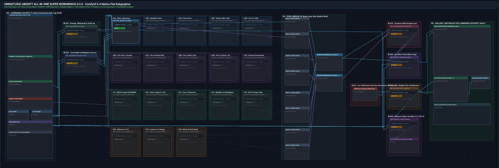

# OmniStudio Ubisoft All-in-One Super Workbench (`v1.0`)

A flagship, zero-lag, 18-architecture ComfyUI (`v0.4`) mega-workbench designed for digital artists and community sharing. It packs **300+ real functional nodes** across **18 self-contained model engines** (covering hot and niche 2025–2026 architectures) plus **6 full pre/post-production stations**, while keeping the Root Canvas down to **~47 clean dashboard blocks (>85% root DOM reduction)** so panning, zooming, and model switching stay silky smooth in both Classic Canvas and Vue Nodes 2.0.



## Why Giant Workflows Usually Lag (And How This One Solves All 4 Layers)

1. **Frontend Canvas & Vue Nodes 2.0 DOM Explosion → Strict 1-Level Flat Native Subgraphs**
   - Every engine and production station is encapsulated in a **ComfyUI `0.4` native Subgraph (`depth = 1`)**.
   - **Never nested 2–3 layers deep**: flat 1-level subgraphs avoid `ComfyUI_frontend`'s double-configuration cold-load and $O(N \times S)$ traversal lag.
   - **Zero `Use Everywhere` (UE) nodes**: eliminates $O(N^2)$ wildcard scanning on every graph tick.
   - **Single Centralized Comparer**: only one `Image Comparer (rgthree)` lives on the root canvas (zero scattered `PreviewImage` WebGL texture bloat).
   - **Native App Mode Ready**: key artist widgets (`ckpt_name` / `unet_name`, `steps`, `cfg`, `guidance`, `shift`, `denoise`) are promoted via `proxyWidgets`.

2. **Missing-Model Red Errors & Prompt-Queue Lag → Root Radio `Fast Groups Muter`**
   - `Fast Groups Muter (rgthree)` sits on the **Root Command Cockpit** (never inside a subgraph, avoiding `rgthree` scope bugs) with `"toggleRestriction": "max one"`.
   - Clicking any of the **18 Model Engines** automatically mutes (`mode: 2`) the other 17. ComfyUI's `graphToPrompt()` strips muted nodes before backend validation, so you **never get errors for checkpoints you have not downloaded**.

3. **Cross-Architecture Model-Switch Crashes → Self-Contained Engine Capsules + Pixel Bridge**
   - SDXL (4-ch VAE, `clip_skip -2`), NoobAI v-pred (`v_prediction` + ZSNR + `RescaleCFG`), Flux.1/2/3 (`FluxGuidance`, `CFG 1.0`, `ae.safetensors`), Anima (`AuraFlow shift 1.73`, Qwen 16-ch VAE), MOSS-Image (`shift 5.0`), Qwen-Image 2.1 (`TextEncodeQwenImage21`), MiniMax-H3 (Split-Sigma), SD 3.5 (TripleCLIP), HiDream (QuadCLIP), and Lumina-2 **never share a naked sampler or VAE**.
   - Each engine runs inside its own capsule and exits as clean **pixel-space `IMAGE` + matched `BASIC_PIPE`** through a 4-bank lazy `Any Switch (rgthree)` bridge.

4. **8–16 GB Consumer GPU OOM Freezes → Toggleable VRAM Checkpoint Gate**
   - `🛠 S07 · Low-VRAM Auto-Flush Gate` (`easy cleanGpuUsed`) sits between the Base Engine Bridge and the heavy SEGS Detailer / 4x HiRes / Video Tail stations to evict heavy DiT weights before post-processing starts.

## 18 Built-in Model Engines (4 Color-Coded Banks)

| Bank | Capsule | Architecture / Highlights |
| :--- | :--- | :--- |
| **Bank A · Anime & Classic** | `E01` SDXL / Illustrious / iLustMix | `CheckpointLoaderSimple`, `CLIPSetLastLayer(-2)`, `LoraManager`, `Power Lora`, `FreeU_V2`, `IPAdapter`, `ControlNet Union`, `DetailDaemon` |
| | `E02` NoobAI / Illustrious V-Pred | `ModelSamplingDiscrete(v_prediction, zsnr=True)` + `RescaleCFG(0.7)` |
| | `E03` Pony V6 XL | Auto `score_9, score_8_up` prefix injector + SDXL eps |
| | `E04` Anima 2.9B / 3.8B | Cosmos DiT + `CLIPLoader(stable_diffusion)` + `AuraFlow 1.73` + optional Turbo LoRA & `TeaCache` |
| | `E05` SD 1.5 / Classic LCM | Legacy checkpoint + bypassable LCM sampling toggle |
| **Bank B · Flux & Flow** | `E06` Flux.1 Dev / Schnell | `UnetLoaderGGUF` + `DualCLIPLoader(flux)` + `ModelSamplingFlux` + `TeaCache` + `FluxGuidance` + `DetailDaemon` |
| | `E07` Flux.1 Kontext (Edit) | `FluxKontextImageScale` + `ReferenceLatent` + `FluxGuidance` |
| | `E08` Flux.2 Klein / Dev | `UnetLoaderGGUF` + `CLIPLoader(flux2)` + `Flux2Scheduler` + `EmptyFlux2LatentImage` |
| | `E09` Flux.3 Layout + KV | `CLIPLoader(flux3)` + `FluxKVCache` + `EmptyFlux2LatentImage` |
| | `E10` Chroma Uncensored | `CLIPLoader(chroma)` + `ModelSamplingAuraFlow` |
| **Bank C · Asian & Mega DiT** | `E11` MOSS-Image INT8/DMD8 | `CLIPLoader(moss_image)` + `AuraFlow 5.0` + bypassable DMD8 8-step LoRA + `VAEDecodeTiled` |
| | `E12` Qwen-Image 2.1 CJK | `CLIPLoader(qwen_image)` + `TextEncodeQwenImage21` + `AuraFlow 3.1` |
| | `E13` Krea-2 Photoreal | `CLIPLoader(krea2)` + 8-step `ConditioningZeroOut` |
| | `E14` MiniMax-H3 SplitSigma | `CLIPLoader(minimax)` + `MiniMaxH3ImageConditioning` + 2-stage `ManualSigmas` |
| | `E15` SD 3.5 Large / Med | `TripleCLIPLoader` + `ModelSamplingSD3(3.0)` + `EmptySD3LatentImage` |
| **Bank D · Quad-CLIP & Niche** | `E16` HiDream-I1 / O1 | `QuadrupleCLIPLoader` + `EmptyHiDreamO1LatentImage` + `TeaCache` |
| | `E17` Lumina-2 / Z-Image | `CLIPLoader(lumina2)` + `CLIPTextEncodeLumina2` + `AuraFlow 6.0` |
| | `E18` Niche 14-Arch Vault | Dropdown-selectable `CLIPLoader.type` covering `omnigen2`, `hunyuan_image`, `longcat_image`, `ovis`, `pixeldit`, `ideogram4`, `boogu`, `joyimage`, `mage`, `fibo2`, `pan2`, `pixart`, `cosmos`, `stable_cascade` |

## 6 Ubisoft Pre- & Post-Production Stations (`🛠`)

- `S01` **Prompt, Wildcards & VLM Intelligence Lab**: `Florence2Run` reverse captioning + `easy wildcards` + `TriggerWord Toggle (LoraManager)` + `PromptAssistantNode` LLM expansion.
- `S02` **ControlNet & IPAdapter Armory**: `AIO_Preprocessor`, `DWPreprocessor`, `DepthAnythingV2Preprocessor` + lazy `easy anythingIndexSwitch` + `ControlNetLoader`.
- `S03` **Anatomy SEGS Surgical Lab**: 4-organ sequential refinement (`Face`, `Eyes`, `Hands`, `Feet`) via `UltralyticsDetectorProvider`, `FaceDetailer`, and `DetailerForEach`.
- `S04` **Dual-Track 4x GAN & Tiled HiRes Forge**: Architecture-agnostic `4x-UltraSharp` pixel upscale + target megapixel clamp + optional `UltimateSDUpscale` tiled 2nd pass.
- `S05` **Film, Relight & De-AI Darkroom**: `LayerColor` (ColorBalance, Levels, Exposure) + `LayerFilter: FilmPost` (35mm grain/halation/vignette) + `ChromaticAberration` + `ImageSharpen` + optional `BiRefNetUltraV2` alpha cutout.
- `S06` **Motion & Video Tail**: Optional `Wan 2.2 I2V` / `LTX-V 2` keyframe animation switcher (muted by default).

## Build, Validate & Preview Locally

```bash
python3 workbench/build_workbench.py
python3 workbench/validate_workbench.py
python3 workbench/render_preview.py
python3 -B -m unittest discover -s workbench/tests
```

See `dist/custom_nodes_manifest.json` for the complete list of 15 custom node packs installable via ComfyUI-Manager, and pair this workflow with [`../canvas-turbo/`](../canvas-turbo/) for live browser LOD, offscreen DOM freezing, and preview texture capping.
