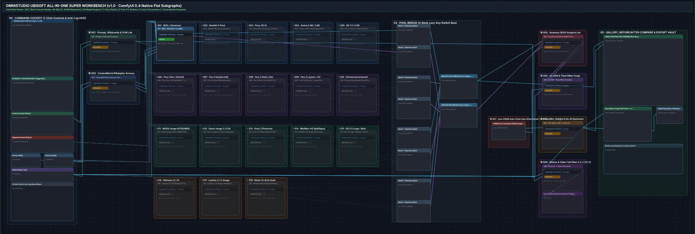

# OmniStudio 育碧罐头超级工作台（`v1.0` · 全模型一图流防卡顿架构）

一套面向业余美术工作者与社区分享的 **ComfyUI `0.4` 全家桶超级工作台**。全图内置 **300+ 真实功能节点**、覆盖市面 **18 大热门与冷门模型引擎舱**（含 14 种冷门 DiT 一键下拉切换）+ **6 座育碧式前后处理工坊**，同时把主画布收敛到 **~47 个清爽战术面板（主画布 DOM 减少 >85%）**，兼顾“视觉压迫感拉满”与“拖动丝滑、一键切模型绝不报红”。



## 四层防卡顿工程架构

1. **治画布掉帧（Classic & Vue Nodes 2.0）**：所有重模块全部封装进 **严格单层扁平原生 Subgraph（`depth = 1`）**，杜绝 2~3 层嵌套子图引发的冷启动重复解析卡顿；**彻底禁用 `Use Everywhere` 无线广播**（根除 $O(N^2)$ 后台扫描）；主画布**仅保留 1 个集中对比预览塔**（`Image Comparer (rgthree)`）；关键旋钮通过 `proxyWidgets` 外置，开箱兼容 ComfyUI 原生 **App Mode**。
2. **治没下全模型就报红 & 运行卡死**：最左侧驾驶舱挂载根级 `Fast Groups Muter (rgthree)` 单选电台模式（`toggleRestriction: "max one"`）。点选任意 1 个模型引擎，其余 17 个引擎自动静音（`mode: 2`），在 `graphToPrompt()` 阶段即被剥离，没装那套权重也绝不报红。
3. **治跨架构切模型黑图/炸参数**：每个底模家族独占一个封闭引擎舱（自带对应加载器、CLIP 类型、Clip Skip / V-Pred / FluxGuidance / AuraFlow Shift / DMD8 / Split-Sigma、专属 LoRA 栈与局部 VAE 解码），统一吐出 **标准像素图 `IMAGE` + 匹配 `BASIC_PIPE`** 经 4 组懒加载 `Any Switch (rgthree)` 汇入后处理厂，切模型绝不串台。
4. **治 8–16G 消费级显卡爆显存假死**：引擎桥出口内置可一键开关的 `🛠 S07 · Low-VRAM Auto-Flush Gate`（`easy cleanGpuUsed`），生完底图先清重权重再进修脸、4 倍放大或视频工坊。

## 3 步上手（业余画师指南）

1. 将 `dist/omni_ubisoft_workbench.ui.json` 拖入 ComfyUI（建议使用 ComfyUI-Manager 安装 `dist/custom_nodes_manifest.json` 里的 15 个常用节点包）。
2. 在最左 **00 · COMMAND COCKPIT** 的 `⚡ ENGINE RADIO SWITCH` 中单点任意 1 个模型引擎（默认启用 `E01 SDXL / Illustrious`），写好正负提示词即可直接出图。
3. 按需在 `🛠 UBISOFT STATION MATRIX` 勾选开启 **Prompt/VLM 反推扩写、ControlNet/IPAdapter、脸/眼/手/脚 SEGS 精修、4x 放大、35mm 胶片调色与抠图、Wan 2.2 / LTX-V 2 图生视频**。

## 本地重建与校验

```bash
python3 workbench/build_workbench.py
python3 workbench/validate_workbench.py
python3 workbench/render_preview.py
python3 -B -m unittest discover -s workbench/tests
```

搭配 [`../canvas-turbo/`](../canvas-turbo/) 轻量前端防卡顿插件使用，可进一步在浏览器端开启远景 LOD 简化渲染、离屏 DOM 冻结与实时 FPS 遥测 HUD。
